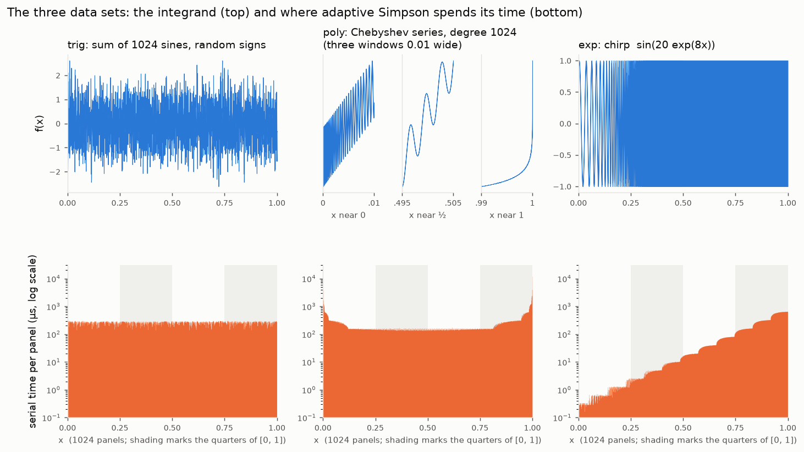

# Activity 4 — Load Balancing Adaptive Simpson Integration

## Background

Lectures 10–12 gave you two ways to say "do these things in parallel": a
**parallel loop** (`#pragma omp parallel for`, `cilk_for`) and **parallel
recursion** (`#pragma omp task`, `cilk_spawn`). Both hand work to threads, but
they decide *how much work each thread gets* in different ways. This activity
uses a computation whose work is uneven to show when that decision matters.

The computation is **adaptive Simpson integration**. Simpson's rule estimates
the integral of `f` over an interval `[a, b]` from three values of `f`:

```
simpson(a, b) = (b - a) / 6 * (f(a) + 4 f(m) + f(b)),    m = (a + b) / 2
```

Adaptive Simpson integration recurses into each region to refine the estimate
within a specified error. It integrates the two halves `[a, m]` and `[m, b]`.
If their sum agrees with the whole within the error, it accepts the interval.
If not, it splits and recurses on each half.

```cpp
static double adapt(double a, double b, double eps, double whole, ...)
{
    double m = (a + b) / 2;
    double left = simpson(a, m), right = simpson(m, b);
    if (std::fabs(left + right - whole) <= 15 * eps)
        return left + right;                         // smooth here: stop
    return adapt(a, m, eps / 2, left, ...) +         // wiggly here: split
           adapt(m, b, eps / 2, right, ...);
}
```

Where `f` is smooth the recursion stops early. Where `f` wiggles, the
recursion goes deep. **How much work it does depends on what `f` looks like
in each region.**

The harness integrates three functions over `[0, 1]`:

| Input | `f(x)` | What it looks like |
|---|---|---|
| `trig` | a sum of 1024 sines with random signs | the same wiggliness everywhere on `[0, 1]` |
| `poly` | a Chebyshev series of degree 1024 | gentle in the middle; wiggles packed tightly near `x = 0` and a steep rise at `x = 1` |
| `exp` | a chirp, `sin(20 exp(8x))` | the frequency grows like `exp(8x)`: calm near `0`, very fast near `1` |



The top row shows each function. The bottom row shows what it costs: the
serial time adaptive Simpson spends on each of the 1024 panels, measured on
an Apple M5. (On a Ryzen AI 9 HX 370 the times differ, but the shapes are the
same.) The bottom row uses a **log scale**, so each gridline up is ten times
more work.

* **`trig`** looks the same everywhere, and every panel costs about the same,
  200–450 µs on the Ryzen.
* **`poly`** looks like a smooth curve at full scale, so the top panel zooms
  into three windows of the same width. Near `x = ½` the window holds three
  gentle wiggles. Near `x = 0` it holds dozens, packed tighter and tighter
  toward `x = 0`. Near `x = 1` the function shoots up. The panels at the two
  ends cost from ten to a hundred times as much as the panels in the middle.
* **`exp`** speeds up from left to right. The cost climbs in steps: each step
  is where the frequency has doubled, so the recursion goes one level deeper
  and the work per panel doubles. The last panels cost thousands of times
  more than the first.

The serial program does the same total work whatever order it takes the
panels in. A parallel program has to split that work among threads, and a
split that is even on `trig` may not be even on the other two.

There are two ways to run this in parallel, and you will write both.

1. **Loop over panels.** Cut `[0, 1]` into 1024 equal **panels** and
   integrate each one serially with `adapt`, each with 1/1024 of the error
   budget. The panels are independent, so this is a parallel loop with a sum.
2. **Parallel recursion.** Run the recursion itself in parallel: integrate
   the two halves of every split at the same time. Below a fixed depth
   (`SPAWN_DEPTH`, 12 by default) the recursion goes back to the serial
   `adapt`, so the tasks aren't too small to be worth creating.

## Grading and feedback

The assignment is worth **100 points: 72 autograded and 28 manually graded**.
Each of the six functions earns up to 12 automated points, in three independent
4-point groups. Every group checks numerical correctness with one worker and
repeated runs with multiple workers, and requires integration work to execute
on more than one thread in the multiworker runs. A serial implementation earns
zero automated points even if it computes the right integral. There are no
points just for compiling.

The grader calls your functions directly, substitutes additional integrands
for `f`, and varies tolerance, worker count (2–4), and `SPAWN_DEPTH`. Preserve
the function names, parameters, serial integration helpers, and harness.
You may add helper functions for a reducer. Do not hard-code the supplied
integrands, answers, four workers, or a recursion cutoff of 12. The grader also
calls each function repeatedly in one process; reset each sum on every call.
The grader uses OpenCilk 3.0, C++17, and `-O3` on Linux.

Scores and concept-level test feedback are available as soon as grading
finishes. Compilation, crash, timeout, and serial-execution feedback are
reported separately. Passing these finite tests does not prove race freedom.
**No fixed speedup is required for automated credit.**

The remaining 28 points cover scheduling/grain/recursion choices (6), results,
plot and comparison (8), load-balancing reasoning (7), and grain-size reasoning
(7). Submit the written work and measurements even if all automated tests pass.

## Getting started

These files come with this assignment:

* [`simpson.linux.cpp`](simpson.linux.cpp) — the harness, with the integrands,
  the serial version and six parallel versions that are still serial. **You
  add OpenMP directives or Cilk keywords and functions to six marked places
  (`TODO (Part 1)`).**
* [`setup_linux.sh`](setup_linux.sh) — sets up OpenCilk's compiler with an
  OpenMP runtime (once).
* [`run.sh`](run.sh) — builds the program and runs every version on every
  input three times.
* [`plot_results.py`](plot_results.py) — plots the results.
* This handout.

This version of the activity runs on Linux on x86-64, and was tested on a
Ryzen AI 9 HX 370 running Ubuntu 24.04 (Pop!_OS). That chip has 4 fast Zen 5
cores, CPUs 0–3, and 8 slower Zen 5c cores, CPUs 4–11. Every run uses the 4
Zen 5 cores:

* `taskset -c 0-3` limits the program to CPUs 0–3;
* `OMP_PLACES=cores OMP_PROC_BIND=spread` gives each OpenMP thread a core of
  its own for the whole run (without it, Linux sometimes puts two threads on
  one core and the speedup changes from run to run);
* the harness times the serial version on the fastest cores it is allowed.

On another Linux machine, find which CPUs are the fastest cores with
`cat /sys/devices/system/cpu/cpu*/cpufreq/cpuinfo_max_freq`, and use four of
them in place of `0-3`.

### Setup (once)

These steps take a fresh Linux x86-64 machine to a working build. The supported baseline is
Ubuntu 24.04. Other Ubuntu releases have not been independently verified here. Run each step on its own, and wait for the prompt to
come back before you start the next one. Don't press Ctrl+C during any step.

**1. Install the system tools:**

```bash
sudo apt update
sudo apt install -y curl g++ cmake python3 python3-venv
```

**2. Create a Python virtual environment:**

```bash
python3 -m venv ~/activity4-venv
```

**3. Activate the virtual environment:**

```bash
source ~/activity4-venv/bin/activate
```

Your prompt now starts with `(activity4-venv)`. Every new terminal needs this step
again before you use `pip3` or `python3` for this activity. To leave the
environment, type `deactivate`.

**4. Install matplotlib** (with `(activity4-venv)` showing):

```bash
pip3 install matplotlib
python3 -c "import matplotlib; print(matplotlib.__version__)"
```

The second command prints a version number, such as `3.11.2`.

**5. Download OpenCilk 3.0** (1.3 GB, about a minute):

```bash
cd ~
curl -fLO https://github.com/OpenCilk/opencilk-project/releases/download/opencilk/v3.0/opencilk-3.0.0-x86_64-linux-gnu-ubuntu-24.04.tar.gz
```

The progress bar ends at `100`. This archive was built for Ubuntu 24.04.

**6. Unpack OpenCilk into `~/opencilk`** (1–2 minutes, no output):

```bash
mkdir -p ~/opencilk
tar xzf ~/opencilk-3.0.0-x86_64-linux-gnu-ubuntu-24.04.tar.gz -C ~/opencilk --strip-components=1
```

**7. Check the compiler:**

```bash
~/opencilk/bin/clang --version
```

The first line should include `clang version 19.1.7`. If you see "No such
file or directory", first check `ls -l ~/opencilk/bin/clang` and confirm that
you downloaded the x86-64 Linux archive. If extraction was interrupted, repeat
step 6 and wait for it to finish. If the executable exists but cannot run,
check `uname -m` (it should report `x86_64`) and your Linux distribution;
re-extracting alone may not fix an architecture or system-library mismatch.

**8. Set up OpenMP for OpenCilk** (a few minutes). In the terminal, go to your
Activity 4 folder, the one that contains `simpson.linux.cpp` and
`setup_linux.sh`. Then run:

```bash
./setup_linux.sh
```

The last line reads `setup ok`.

OpenCilk comes without an OpenMP runtime. The one Ubuntu packages
(`libomp-dev`, LLVM 18) is older than OpenCilk's clang, and with it
`schedule(dynamic)` fails to link with "undefined reference to
`__kmpc_dispatch_deinit`". `setup_linux.sh` builds the matching runtime into
`~/opencilk` and sets up the compiler to find it.

Once step 7 works, you can delete the download to free 1.3 GB:

```bash
rm ~/opencilk-3.0.0-x86_64-linux-gnu-ubuntu-24.04.tar.gz
```

**Each later session**, open a new terminal, activate the virtual environment
with `source ~/activity4-venv/bin/activate`, and go to your Activity 4 folder.

**Starting over:** if the activity's Python environment is broken, deactivate
it (only if active), then rename it before recreating it:

```bash
mv ~/activity4-venv ~/activity4-venv.backup
python3 -m venv ~/activity4-venv
source ~/activity4-venv/bin/activate
pip3 install matplotlib
```

Choose a different backup name if that backup already exists. Keep an existing
OpenCilk installation until you have diagnosed the problem; it may be shared
with other coursework. Ask course staff for help if the compiler or setup
script still fails, including the command and complete error message.

### Build and run

**Build:**

```bash
~/opencilk/bin/clang++ -fopencilk -fopenmp -O3 -std=c++17 simpson.linux.cpp -o simpson
```

**Run** one version on one input, with 4 threads on the 4 Zen 5 cores:

```bash
OMP_PLACES=cores OMP_PROC_BIND=spread OMP_NUM_THREADS=4 taskset -c 0-3 ./simpson omp_static exp
CILK_NWORKERS=4 taskset -c 0-3 ./simpson cilk_spawn exp
```

Each run times the serial version first, then the version you named, and
prints both, the speedup, and how far the parallel answer is from the serial
one:

```
omp_static   exp   eps 1e-12: serial   245.87 ms, parallel   216.60 ms, 4 threads, speedup  1.14x, rel. diff 6.2e-16
```

Run the starter before you change anything. Every version runs, gives the
right answer, and reports a speedup of about `1.00x`: it is still serial.

> **The relative difference should stay below about `1e-13`.** A parallel sum
> adds the same numbers in a different order, so the last digit or two can
> change. A larger difference, or a different answer on every run, means two
> threads are writing the same variable at once.

Close other CPU-heavy programs, keep the machine plugged in, and record your
processor, Linux distribution and version, and OpenCilk version with your
results.

## Part 1 — Parallelize six functions (78 points: 72 automated, 6 manual)

Each function below has a `TODO (Part 1)` comment above it. Add OpenMP
directives or Cilk keywords to make it parallel, and make `sum` safe to update
in parallel. In the four loop versions, many threads add to `sum` at the same
time, so you will need to use features of OpenMP or Cilk to make those
concurrent updates safe. The intended changes are small; leave the integration
algorithm and harness alone. Equivalent thread-safe sums are accepted, including OpenMP
reductions, atomic updates, or critical sections and valid Cilk reducers.

| Version | Function | What to write |
|---|---|---|
| `omp_static` | `omp_static` | an OpenMP parallel loop over the panels, **static** schedule |
| `omp_dynamic` | `omp_dynamic` | the same loop with a **dynamic** schedule that hands out one panel at a time |
| `omp_task` | `adapt_omp` | make the left half an OpenMP **task**, compute the right half, and **wait** for the task before adding |
| `cilk_for` | `cilk_for_panels` | the loop over panels with `cilk_for` and Cilk's **default** grain size |
| `cilk_for_g1` | `cilk_for_grain1` | the same `cilk_for` with a grain size of **1** |
| `cilk_spawn` | `adapt_cilk` | **spawn** the left half, compute the right half, and **sync** before adding |

Notes:

* In `adapt_omp`, the task writes `l`, which is a local variable of the
  function that creates it. OpenMP tasks get a *private copy* of local
  variables by default. Make sure the task writes the `l` that the function
  adds up after the wait.
* `omp_task` already starts a team of threads (`#pragma omp parallel`) and
  has one of them begin the recursion (`#pragma omp single`). The other
  threads run the tasks it creates.

Test each version on all three inputs as you go, including with 1, 2, and 4
workers. Check that the answers agree with serial and investigate whether the
`trig` workload speeds up on your machine. Speedup is evidence to discuss,
not a universal threshold for earning credit. The 6 manual code points assess
the specified static/dynamic schedules, default/unit grains, and task/spawn
structure and cutoff; numerical tests alone cannot establish these choices.

## Part 2 — Measure and plot (8 points)

Activate `~/activity4-venv` in each new terminal. Run every version on every
input, three times, then plot the results:

```bash
./run.sh
python3 plot_results.py results.txt speedup.png "4 Linux cores (record CPU model)"
```

`run.sh` rebuilds `simpson` from your `simpson.linux.cpp` first, and takes
a few minutes. The plot shows, for each input, the median speedup of each
version as a bar, with a black line from the slowest to the fastest of the
three runs.

Submit `speedup.png` and `results.txt` (5 points for complete,
consistent measurements and a labeled plot). Keep all 54 measurements: three
runs of six versions on each of three inputs.

**(a), 3 points.** Which input gives nearly the same speedup for all six versions? On
which input do the versions differ the most? Give the best and the worst
version on that input, with their speedups.

==---==

## Part 3 — Static vs. dynamic scheduling (7 points)

The harness can show you how the work is spread across `[0, 1]`. The `skew`
mode times each of the 1024 panels serially, and prints how the work divides
among the four quarters of `[0, 1]`:

```bash
taskset -c 0-3 ./simpson skew trig
taskset -c 0-3 ./simpson skew poly
taskset -c 0-3 ./simpson skew exp
```

**(b), 4 points.** With a static schedule and 4 threads, which panels does each thread
integrate? From the work in each quarter, what is the best speedup a static
schedule could reach on each input? How close does your measured `omp_static`
speedup come to it?

==---==

**(c), 3 points.** What properties of the data make dynamic scheduling improve
performance over static scheduling? Explain the expected differences among
the three inputs and compare with your measurements. Discuss any departures
from the expected trend.

==---==

## Part 4 — Grain size (7 points)

A parallel loop splits its iterations into **chunks** (OpenMP) or **grains**
(Cilk). A chunk is the unit of scheduling: one thread runs a whole chunk,
start to finish, and a chunk is never split further.

**(d), 1 point.** What is OpenMP's default chunk size for `schedule(dynamic)` when you
don't give one? Does it depend on the number of iterations or threads?

==---==

**(e), 2 points.** What is the default grain-size heuristic in your OpenCilk version? Cite
your compiler/runtime version and a documentation or implementation source.
Give the formula (and any rounding)
and its value for this loop (1024 panels) on 4 workers. How many grains does
the loop become, and what fraction of `[0, 1]` does each one cover?

==---==

**(f), 3 points.** Compare `cilk_for` and `cilk_for_g1` on your plot. Does a grain
size of 1 improve the uneven inputs on your machine? Explain the result,
including any differences from the expected trend. Reason about the data:
use the `skew` output to estimate how much of the work the costliest
grain holds under the default grain size, and what that does to the
other workers.

==---==

**(g), 1 point.** (d) and (e) are very different defaults for the same job. What does
each one assume about the iterations of a loop? Which assumption fits this
loop?

==---==

## What to submit

Upload your `simpson.linux.cpp` to the Gradescope programming assignment.
Upload only one solution. A unique `.cpp` is accepted, including inside an
uploaded folder. The grader first recognizes `simpson.M5.reference.cpp`,
`simpson.M5.cpp`, and `activity4_submission.cpp`, in that order; avoid uploading
these alongside your Linux solution. A filename containing `reference`
receives no special credit.

Submit measurements, plot, and a PDF with answers (a)–(g) and machine details
to the written-work submission. The code and manual components sum to 100.

* Your `simpson.linux.cpp`, with the six functions parallelized.
* `speedup.png` and `results.txt` from Part 2.
* Your answers to (a)–(g), and your machine details.
