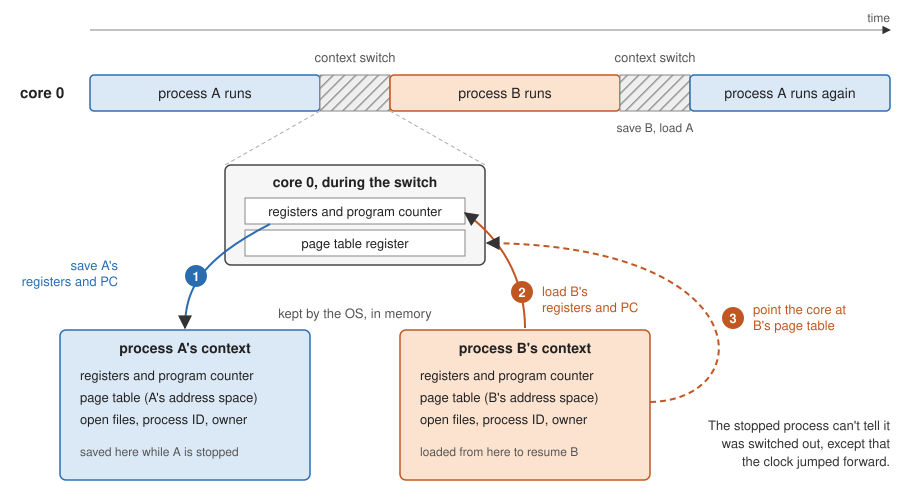
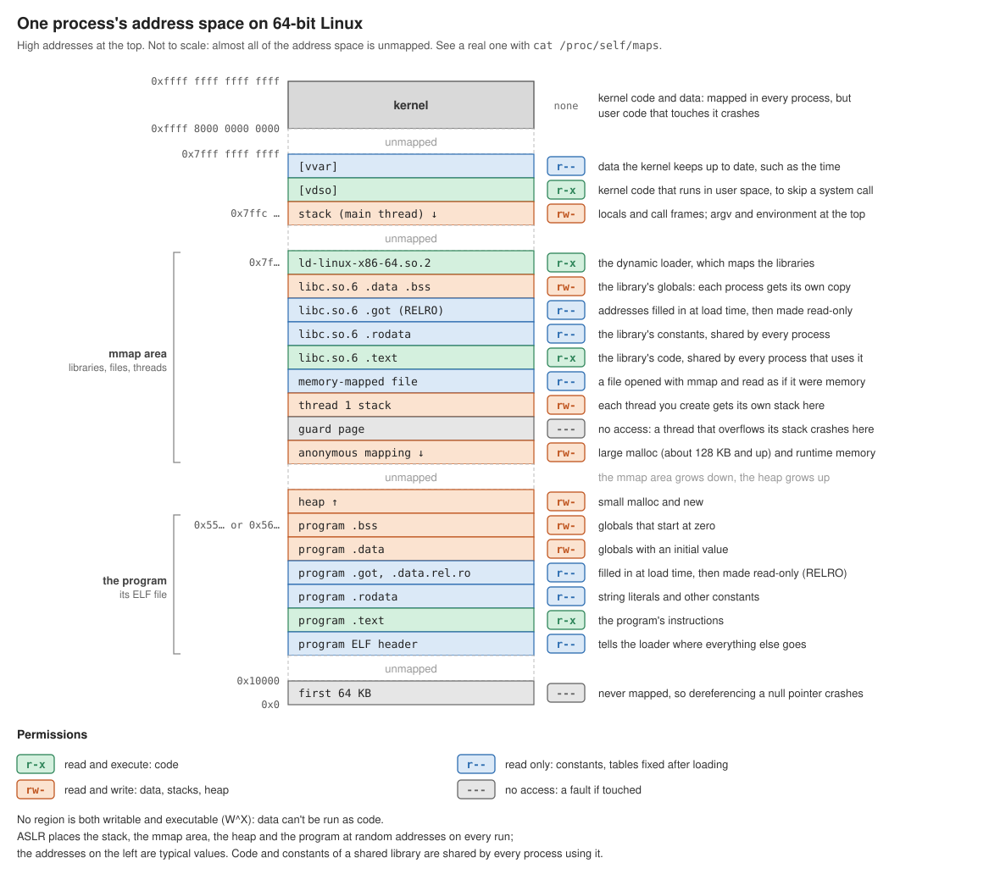
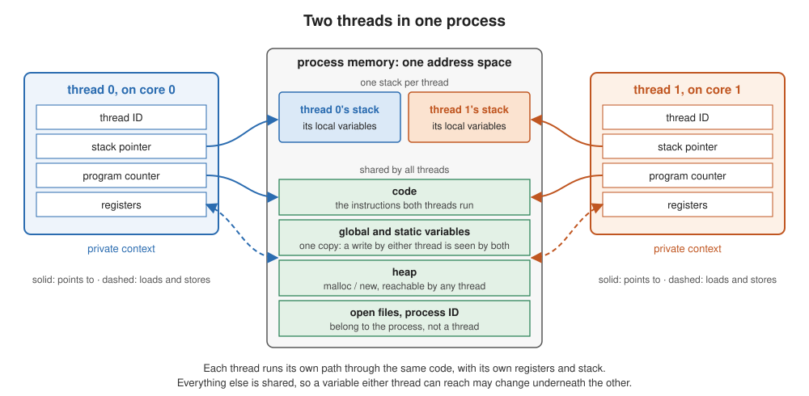

# Processes and Threads

Learning goals:
  * Understand the process as the operating system's abstraction for a running program
    * the two illusions it provides: a CPU of its own and a memory of its own
    * context and the context switch, which make the first illusion work
    * virtual memory, which makes the second one work
  * Understand the thread as a second, lighter abstraction inside a process
    * what threads share (the address space) and what each keeps (registers, stack)
    * why a thread is cheaper to create and switch than a process
  * Weigh the trade-off between the two
    * processes: isolation by default, communication is explicit and clunky
    * threads: sharing by default, communication is easy and bugs are hidden
  * Know why equal work is not equal time on a modern chip
    * performance and efficiency cores, and why an equal split of the work can fail

(This content was generated by Claude Opus 5.5 based on a prior lecture from
Randal Burns and edited by Randal Burns.)


# Examples

  * [examples/virtual_memory/](../examples/virtual_memory/README.virtual_memory.md) — the process's memory abstraction, measured
    * [vm_intro.html](../examples/virtual_memory/vm_intro.html) — a gentle introduction to address spaces and `fork`
    * [same_address.c](../examples/virtual_memory/same_address.c) — two processes, one virtual address, two different memories
    * [cow_fork.c](../examples/virtual_memory/cow_fork.c) — what `fork` copies and when
  * [examples/false_sharing/](../examples/false_sharing/README.false_sharing.md) — what shared memory costs when two threads touch the same cache line
  * [examples/threads_on_cores/](../examples/threads_on_cores/README.threads_on_cores.md) — where the scheduler puts the threads of a threaded program and of a set of processes

---

## Where this picks up

Everything so far has been about one core running one stream of instructions.
The pipeline, out-of-order execution, the caches and the vector units all exist
to make that one stream go faster.

To use more than one core, a program needs more than one stream of instructions.
Something has to create those streams, give each one a core, and keep them from
trampling each other. That something is the operating system, and it offers two
abstractions for the job: the **process** and the **thread**.

Some vocabulary we will use for the rest of the course (from Mattson, Sanders and
Massingill, *Patterns for Parallel Programming*):

| | | |
|---|---|---|
| **Task** | a sequence of instructions that operate as a group | a loop iteration, a recursive call |
| **Unit of execution (UE)** | the execution context that runs a task | a process or a thread |
| **Processing element (PE)** | the hardware that runs a UE | a core |

OpenMP threads and Cilk workers are both UEs, and both are threads. This lecture
explains what that word means.

---

## Processes

> "A process is the operating system's abstraction for a running program."
> — Bryant and O'Hallaron, *Computer Systems: A Programmer's Perspective*

A process provides **the illusion that the program is the only one running on the
system**. Each process appears to have:

  * **exclusive use of the processor**, executing its instructions one after
    another without interruption
  * **exclusive use of memory**, an address space that no other program can see
    or touch

Neither is true. Open Activity Monitor, Task Manager or `top` on your laptop and you
will find several hundred processes sharing about ten cores and one set of DRAM
chips. The process abstraction is what lets each of them be written as if it were
alone.

The idea dates from the [time-sharing](https://en.wikipedia.org/wiki/Time-sharing)
systems of the 1960s, where it let many users share one expensive computer. It
survives because isolation is useful for much more than sharing a computer:

  * a crash in one process cannot corrupt another
  * one process cannot read another's memory, so a browser runs each website in
    its own process to keep a malicious page away from your bank's tab
  * containers (Docker and its relatives) are groups of processes with even
    stronger walls around them

### Context and the context switch

The first illusion, a processor of its own, is made by switching. The OS lets a
process run for a few milliseconds, stops it, saves everything needed to resume
it, and starts another. That saved state is the process's **context**:

  * the program counter and the rest of the register file
  * the address space: its memory contents, and the page table that maps them
  * OS bookkeeping: open files, process ID, owner, and so on

A **context switch** saves one process's context and loads another's. It is
transparent: the process that was stopped cannot tell, except that the clock
jumped forward.



On one core this is **concurrency**: the processes take turns and appear to run
at the same time. With many cores the OS can also run them truly at the same
time, which is **parallelism**. The program is written the same way in both cases.

### Virtual memory

The second illusion, a memory of its own, is virtual memory. Every address a
program uses is a *virtual* address. The hardware translates it through the
process's page table to a physical location, and each process has its own page
table. Two processes can use the identical address and reach different memory.
[same_address.c](../examples/virtual_memory/same_address.c) shows exactly that.

Each process's address space holds the whole state of one program. Every region
has its own permissions, which the hardware checks on every access:



Lecture 05 covered what happens to an address *after* translation: caches, lines
and the TLB. The [virtual_memory examples](../examples/virtual_memory/README.virtual_memory.md)
cover the translation itself.

### Creating processes: `fork`

On Unix, a process creates another with `fork()`, which makes a copy of the
caller. The parent and the child continue from the same line with identical
memory, but the memory is **copied, not shared**. A write in one is invisible to
the other:

```c
int x = 0;

int main(void) {
    if (fork() == 0) {          // child
        x = 42;
        return 0;
    }
    wait(NULL);                 // parent waits for the child to finish
    printf("parent sees x = %d\n", x);     // prints 0
}
```

A modern OS doesn't copy every page at `fork` time. Parent and child share the
pages read-only until one of them writes, and only then is that page copied
(*copy-on-write*). Even so, creating a process isn't free.
[cow_fork.c](../examples/virtual_memory/cow_fork.c) measures 2.7 ms to fork a
process holding 256 MB on the course machine, before any page is copied.

### Process properties

**No shared state.** That is both the strength and the weakness.

  * Processes that need to cooperate must communicate explicitly, through
    **inter-process communication (IPC)**:
    * pipes (the `|` in `ls | grep foo`)
    * sockets, and everything built on them: HTTP, RPC frameworks like gRPC
    * files
    * a shared-memory region that both processes deliberately map
  * Every one of these is clunkier and slower than reading a variable
  * But no shared state also means **no hidden dependencies**. A process can only
    be affected by what it explicitly receives, which makes parallel programs
    built from processes simple to reason about:

---

## Threads

A **thread** is an independent stream of execution *within* a process.

  * All the threads of a process **share its address space**: the code, the
    globals, the heap and the open files
  * Each thread has its **own, lightweight context**:
    * a thread ID
    * a program counter and registers
    * a stack, for its own local variables and call frames

| shared by all threads in a process | private to each thread |
|---|---|
| code | program counter |
| global and static variables | registers |
| heap | stack (local variables) |
| open files, process ID | thread ID |



Every process has at least one thread: the **main thread**, the one that runs
`main()`. A process may create more. The OS schedules *threads* onto cores, so the threads of one process can run on different cores at the same time. That is how a single program uses a multicore machine.

Here is the `fork` example again with a thread. The thread writes the same
global, and this time the write is visible, because there is only one `x`:

```c
int x = 0;

void *set_x(void *arg) {
    x = 42;
    return NULL;
}

int main(void) {
    pthread_t t;
    pthread_create(&t, NULL, set_x, NULL);
    pthread_join(t, NULL);      // main waits for the thread to finish
    printf("main sees x = %d\n", x);       // prints 42
}
```

`pthread_create` / `pthread_join` are the POSIX thread interface, which OpenMP
uses underneath on Linux and macOS. 

### Lightweight Context 

A thread's context leaves out the most expensive part of a process's context:
the address space.

  * **Creating** a thread allocates a stack and some registers' worth of state.
    There is no new page table and nothing to copy.
  * **Switching** between two threads of the same process doesn't change the
    page tables, so the translations the hardware has cached stay useful.

Cheaper is not free. Creating a thread still costs tens of microseconds, which is
why real systems create a **pool** of threads once and hand them work, rather
than creating a thread per task. OpenMP and Cilk both keep a pool for exactly
this reason: OpenMP creates its team of threads at the first parallel region
and reuses it for every one after.

### Thread Properties

**Shared variables.** 

  * Communication is easy. Threads cooperate by reading and writing ordinary
    variables, with no IPC.
  * Dependencies are hidden. Any variable that can be reached from more than one
    thread may change underneath you. Code that was correct serially can be wrong
    when two threads run it, as the example below shows.
  * Sharing also costs performance when threads write data that happens to sit
    on the same cache line, even if the variables are different.
    [false_sharing](../examples/false_sharing/README.false_sharing.md) measures it.

**A race, step by step**

Two threads run the same line at the same time. `sum` is a shared global that
starts at 10. Thread 0 adds its element, 1, and thread 1 adds its element, 2,
so the answer should be 13.

```c
sum += a[i];
```

That one line compiles to three instructions (x86-64):

```
mov  eax, dword ptr [sum]        ; load sum into a register
add  eax, dword ptr [a + 4*i]    ; add a[i]
mov  dword ptr [sum], eax        ; store the result back into sum
```

Each thread has its own `eax`, because registers are private, but there is only
one `sum`. Here is one way the six instructions can interleave:

| step | thread 0 (adds 1) | thread 1 (adds 2) | `sum` in memory |
|---|---|---|---|
| 1 | `mov eax, [sum]`: eax = 10 | | 10 |
| 2 | | `mov eax, [sum]`: eax = 10 | 10 |
| 3 | `add eax, [a + 4*i]`: eax = 11 | | 10 |
| 4 | | `add eax, [a + 4*i]`: eax = 12 | 10 |
| 5 | `mov [sum], eax`: sum = 11 | | 11 |
| 6 | | `mov [sum], eax`: sum = 12 | **12** |

The result is 12, not 13. Thread 1 loaded `sum` before thread 0 stored its
result, so thread 1's store overwrote thread 0's: a **lost update**. Run all of
thread 0's steps before thread 1's and the answer is 13. Which order happens
depends on timing the program doesn't control, so this is a **race condition**:
the program can work in a thousand runs and fail on the next one.

Writing the update as a single instruction, `add dword ptr [sum], eax`, doesn't
help. Inside the core it is still a load, an add and a store, and another core
can get in between them. Only with the `lock` prefix, `lock add dword ptr [sum], eax`,
does the hardware make the three steps indivisible. That is what an atomic
operation compiles to, but this has performance consequences.


Modern parallel frameworks use a design rule:

> **Private by default. Share explicitly. Synchronize every shared write.**

  * Keep each thread's working data private: local variables, its own slice of
    an array, its own partial sum.
  * Make shared data an explicit, visible decision, not an accident of scope.
  * Protect writes to shared data with synchronization: a lock, an atomic
    operation, or a construct that does it for you.

You will see this rule again in OpenMP's `private` and `shared` clauses, in its
`reduction` clause and in Cilk's reducers, which are all ways of giving each
thread a private copy and combining the copies safely. Some languages go further:
Rust's compiler rejects a program that shares a variable between threads without
synchronization.

(One trap in C and C++: `volatile` is not synchronization. It doesn't make
`sum += a[i]` safe. Use `std::atomic`, a mutex, or a reduction.)

---

## Not all cores are equal

Modern chips mix core types. The M5 has 4 performance cores and 6
efficiency cores. The course machine has 4 Zen 5 cores and 8 smaller Zen 5c
cores. The OS decides which thread goes where.

This matters for parallel programs. Split the work into equal pieces, one per
thread, and the pieces on the slower cores finish last while the fast cores sit
idle. Equal work is not equal time. That is one of the reasons that many schedulers
 hand out work dynamically instead of all at once.

---

## Threads on cores

The OS schedules threads, not processes. A single-threaded process is one
thread to the scheduler, and a process with eight threads is eight. The
scheduler does know which threads share an address space, and it uses that in
small ways. Switching a core between two threads of the same process skips the
page-table switch. On machines with several memory controllers, it tries to keep
threads that share memory near that memory. But when it decides who gets a
core, each runnable thread counts on its own. A process with eight threads
competes for cores like eight single-threaded processes.

### How thread scheduling works

At any moment a thread is either **runnable**, meaning it has work to do and
wants a core, or **sleeping**, meaning it is waiting for something: a disk
read, a network packet, a lock, another thread at a barrier, a child process
to exit.

  * Each core keeps a queue of runnable threads. It runs one of them for a
    **time slice** of a few milliseconds. If others are waiting, it then
    context-switches to the next one.
  * A thread that goes to sleep leaves the queue, and its core goes to another
    thread at once. A sleeping thread costs no core time.
  * When a thread wakes up, the scheduler picks a core for it. This is often
    whichever core is idle, not the core the thread last ran on.
  * Every so often the scheduler rebalances the queues so that no core is idle
    while another has a backlog. It does this by moving threads from one core
    to another (**migration**).

So a thread doesn't own a core. With fewer runnable threads than cores, each
thread gets a core to itself, but not necessarily the same one from moment to
moment. With more runnable threads than cores, the cores are shared in turns.

The scheduler also doesn't know what a thread is computing. It can't tell
that one thread is holding up seven others at a barrier, and it doesn't move
that thread to a faster core on purpose. On the course machine, the kernel's
ranking of preferred (faster) cores is turned off, so nothing deliberately
steers work to the Zen 5 cores either.

### An experiment

[examples/threads_on_cores/](../examples/threads_on_cores/README.threads_on_cores.md)
runs two programs side by side on the course machine's 12 cores:

  * **matmul**: one process with a team of K OpenMP threads, repeating a
    1024 × 1024 matrix multiply. `#pragma omp parallel for` gives each thread
    an equal share of the rows, and every multiply ends at a barrier.
  * **workers**: the `fork` example in a loop. The parent `fork()`s K
    single-threaded children, and each one computes in a loop that never
    sleeps.

A small program reads `/proc` every 10 ms and records which core every thread
is on. Each figure has one row per core, with time running across. Blue
shades are the matmul's threads, and orange shades are the worker processes.

**8 threads on 12 cores.** With 4 matmul threads and 4 workers, every thread
can have a core of its own:


  * **Threads move all the time.** Every thread changed cores 50 to 110 times
    in 10 seconds, even though 4 cores were idle at any moment.
  * **The workers got the fast cores.** The workers spent 52–73% of their time
    on the 4 Zen 5 cores, and the matmul threads 32–35%. An even spread would
    be a third each. Repeat runs gave the same picture.

The scheduler didn't favour the workers for being processes. It favoured
them because they never sleep. A matmul thread finishes its equal share of
rows and sleeps at the barrier, waiting for a sibling on a slower Zen 5c
core. The moment it sleeps, it gives up its fast core, and a worker that was
waiting for one takes it. This is the point from the previous section in
action: equal work isn't equal time, and the cost of the gap is more than
idle time.

**16 threads on 12 cores.** With 8 matmul threads and 8 workers, there are
more threads than cores:


  * **Every core is shared in turns.** Each change of colour within a row is a
    context switch. This is concurrency on each core, on top of parallelism
    across the 12.
  * **The threaded program pays more.** Each worker ran 80–87% of the time and
    each matmul thread only 55–67%. When one matmul thread loses its core, its
    siblings reach the barrier and sleep until it catches up, so a delay to
    one thread is a delay to all of them.
  * **More threads were not more work.** Without the sampler running, the
    matmul finished 61–62 multiplies in 11 seconds with 4 threads and 63 with
    8.

Two lessons carry into OpenMP. Don't create more runnable threads than cores
for compute-bound work. And a static, equal split of the work is fragile on a
machine where cores differ and other programs share them, which is why the
schedulers in the next lectures hand out work dynamically.

---

## What to carry forward

| | process | thread |
|---|---|---|
| **what it is** | a running program | a stream of execution inside a process |
| **memory** | its own address space | shares the process's address space |
| **private context** | registers, PC, address space, OS state | registers, PC, stack |
| **communication** | explicit IPC: pipes, sockets, shared mappings | ordinary variables |
| **the risk** | clunky, slow communication | races and hidden dependencies |
| **creation cost** | milliseconds (`fork`) | tens of microseconds; use a pool |
| **used by** | `make -j`, MPI, browsers | OpenMP, Cilk, C++ `std::thread` |

OpenMP is next. It runs one process with a team of threads and splits a loop
among them, and it lets you choose how the work is divided, which is the
answer to "equal work is not equal time". Its syntax for "private by default,
share explicitly" comes in a later lecture on shared data.

## Reading On Your Own

This lecture treated virtual memory in a few paragraphs. It gets more room in
[examples/virtual_memory/](../examples/virtual_memory/README.virtual_memory.md),
which covers it twice, first as the abstraction and then as the reality. Read the
two pages in order. Both are standalone, so open them in any browser.

  1. **The abstraction:** [vm_intro.html](../examples/virtual_memory/vm_intro.html),
     *Three Illusions*. It explains from first principles, with no measurements,
     what virtual memory, `malloc` and `fork` actually do. It explains why your
     addresses are not physical addresses, why `malloc` hands out addresses before
     memory, and how `fork` duplicates a process without copying it.
  2. **The reality:** [vm_reality.html](../examples/virtual_memory/vm_reality.html),
     *The Address Is Not The Memory*. It covers the same mechanisms, measured on
     the course machine. It shows how little of a process's address space is
     actually used, what a page fault costs, and what copy-on-write looks like
     page by page.

The five small C programs behind those measurements are in the same directory.
On Linux, `make data` reruns them all in about 30 seconds. Compare your numbers
with the ones on the page.

As you read, connect it back to this lecture:

  * Which of the two illusions from the start of the lecture does virtual memory
    provide, and what is the mechanism?
  * [same_address.c](../examples/virtual_memory/same_address.c) puts two
    processes at the identical address. When do they see the same memory, and
    when don't they? How is that different from two threads using the same
    address?
  * `fork` of a 256 MB process takes milliseconds but copies no pages. What does
    it copy, and why would creating a thread instead copy none of it?

