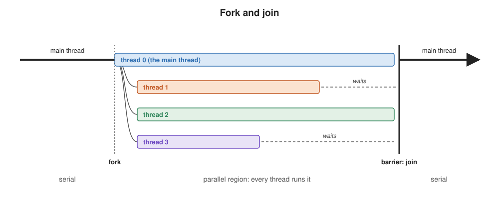
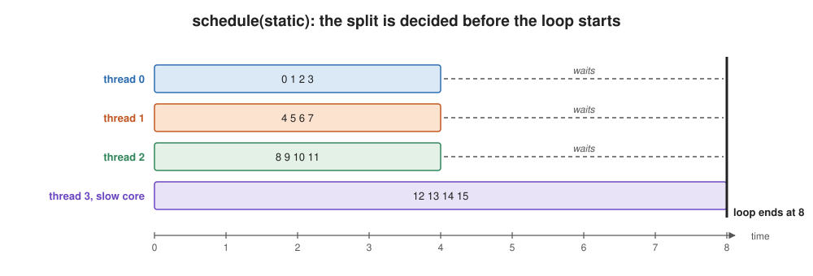
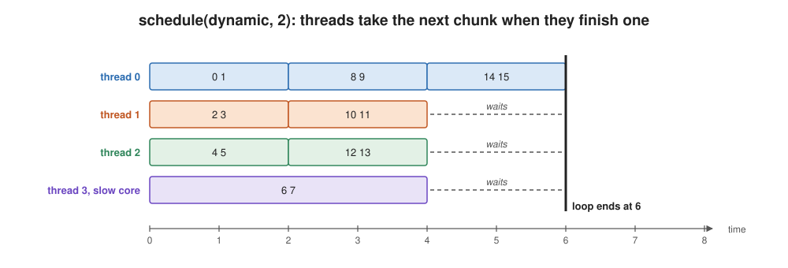

# OpenMP

Learning goals:
  * Understand OpenMP's model: a serial program, plus directives that fork a
    team of threads and join it again
    * the team is created once and reused, like the thread pool in Lecture 09
    * every parallel region ends at a barrier, so it takes as long as its
      slowest thread
  * Know the primitives for dividing work, and what each one is for
    * `parallel`: run a block on every thread of a team
    * `for`: split a loop's iterations among the team
    * `task`: create work as you go, for recursion and other irregular work
  * Understand scheduling: how `for` decides which thread gets which iterations
    * `static` decides before the loop starts; `dynamic` decides as it runs
    * why an equal split is not an equal finish, on unequal cores or unequal
      iterations, and how a smaller chunk trades overhead for balance
  * Know what a parallel region costs, and why it must buy enough work

(This content was generated by Claude Opus 5.5 based on prior lectures from
Randal Burns and edited by Randal Burns.)


# Examples

  * [examples/openmp/](../examples/openmp/) — one primitive per file, each short and commented
    * [openmp_intro.ipynb](../examples/openmp/openmp_intro.ipynb) — the lab: build and run the examples
    * [hello_omp.c](../examples/openmp/hello_omp.c) — `parallel`
    * [vector_add.c](../examples/openmp/vector_add.c) — `parallel for`
    * [fib.c](../examples/openmp/fib.c) — `task` and `taskwait`
  * [examples/cilk/sparse_col_sum.c](../examples/cilk/sparse_col_sum.c) — `schedule(static)` vs. `schedule(dynamic)` on a loop whose iterations differ wildly in cost ([write-up](../examples/cilk/sparse_col_sum.md))
  * [examples/threads_on_cores/omp_matmul.c](../examples/threads_on_cores/omp_matmul.c) — the OpenMP program from Lecture 09's experiment

---

## Where this picks up

Lecture 09 described threads: streams of execution that share one address
space, each with its own registers and stack. Three of its facts drive this
lecture.

  * Creating a thread costs tens of microseconds, so real systems create a pool
    once and reuse it.
  * The OS decides which core runs each thread, and cores are not all equal.
    **Equal work is not equal time.**
  * In Lecture 09's experiment, a team that split its work evenly waited, at
    every barrier, for whichever thread had landed on a slow core.

You could program threads directly with `pthread_create` and `pthread_join`,
splitting the work by hand and passing each thread a struct of arguments. Most
of that code would be the same in every program. OpenMP writes it for you, and
gives you a choice of how the work is divided.

This lecture is about **dividing work**. Threads that share variables also
share the danger of races (Lecture 09's `sum += a[i]`), and OpenMP has clauses
for that, but they are the subject of a later lecture. Every loop here has
**independent iterations**: each one writes only its own results.

---

## What OpenMP is

OpenMP is not a language. It is a set of **directives** (`#pragma omp ...`)
that you add to an ordinary C, C++ or Fortran program, plus a small runtime
library. The compiler turns each directive into calls to the runtime, which
manages a team of threads.

The workflow is **serial to parallel**:

  1. Write and debug a serial program.
  2. Profile it and find the loops that take the time.
  3. Add a directive to each of those loops.

Remove the directives, or compile without OpenMP, and you get the serial
program back. That makes OpenMP **incremental**: you parallelize one loop at a
time and check the answer after each one. It is the easiest way to make an
existing program use more cores. It is not always the best way, because the
fastest parallel design is sometimes a different algorithm, not the serial one
with directives on it.

What OpenMP can't do:

  * It is for **shared memory**: threads in one process on one machine. It
    can't spread a program across a cluster, which is MPI's job.
  * It gives you little control over **where data lives**. All threads see one
    address space, but which core's cache holds which data is up to the
    hardware, and Lectures 05 and 06 showed how much that matters.

### Compiling

There is no separate toolchain. One compiler flag turns the directives on and
links the runtime: `libgomp` with gcc, `libomp` with clang.

```bash
# Linux
gcc -fopenmp -O3 program.c -o program

# macOS, with Homebrew's libomp
clang -Xpreprocessor -fopenmp -O3 \
  -I/opt/homebrew/opt/libomp/include \
  -L/opt/homebrew/opt/libomp/lib -lomp \
  program.c -o program
```

Add `#include <omp.h>` to call the runtime functions, such as
`omp_get_thread_num()`.

The team size defaults to the number of CPUs the OS reports. Set it with an
environment variable:

```bash
OMP_NUM_THREADS=8 ./program
```

Lecture 09's experiment is the reason to set it on purpose: don't run more
compute-bound threads than cores. On a machine with simultaneous multithreading
(two hardware threads per core), the default is twice the number of cores.

---

## The fork-join model

An OpenMP program starts with one thread, the **main thread**. At a
**parallel region**, the main thread **forks** a team of threads, and every
thread runs the region. At the end of the region, the team **joins**: every
thread waits at a **barrier** until all of them arrive, and then only the main
thread continues.



Two things in this picture matter for performance:

  * **The team is a pool.** The threads are created at the first parallel
    region and kept. Later regions reuse them, so a fork after the first one
    costs much less than creating threads.
  * **The region takes as long as its slowest thread.** Everyone waits at the
    barrier. In Lecture 09's experiment, threads that landed on the slower Zen 5c
    cores held up the whole team at every barrier.

### What a parallel region costs

Even with a pool, a region isn't free: the main thread has to wake the team,
hand out the work, and wait at the barrier. How much that costs depends on what
the idle threads do between regions.

  * **Spin.** Idle threads keep checking for new work. The next region starts
    within about a microsecond, but idle threads burn their cores while they
    wait. Linux runtimes spin for a while (libomp for 200 ms) before sleeping.
  * **Sleep.** Idle threads give their cores back to the OS, and the next region
    has to wake them. The Homebrew libomp on macOS sleeps immediately by default.

Measured on an Apple M5 with 10 threads, an empty parallel loop cost **16 µs**
with the default (sleep), and **1.2 µs** with `KMP_BLOCKTIME=infinite` (spin).
Either way, the work in a region has to be large compared with its cost. A loop
that does 50 µs of work can't gain much from a region that costs 16 µs.

---

## `parallel`: a team runs a block

```c
#pragma omp parallel
{
    int tid = omp_get_thread_num();        // 0, 1, ..., T-1
    int nthreads = omp_get_num_threads();  // T
    printf("Hello from thread %d of %d\n", tid, nthreads);
}
```

Every thread in the team runs the whole block. With four threads this prints
four lines, in whatever order the threads happen to reach `printf`, and the
order changes from run to run.

`parallel` by itself doesn't divide any work. Each thread can find its own share
using its number, `omp_get_thread_num()`. Here is a loop split by hand into one
contiguous chunk per thread:

```c
#pragma omp parallel
{
    int t = omp_get_thread_num(), T = omp_get_num_threads();
    long chunk = (N + T - 1) / T;                // round up
    long lo = t * chunk;
    long hi = lo + chunk < N ? lo + chunk : N;
    for (long i = lo; i < hi; i++)
        c[i] = a[i] + b[i];
}
```

That works, and sometimes you need exactly this kind of control:
[omp_prefix_sum.c](../examples/prefix_sum/omp_prefix_sum.c)
uses it because each thread must own one contiguous block. But for an ordinary
loop it is boilerplate, and the next primitive writes it for you.

---

## `for`: split a loop among the team

```c
#pragma omp parallel for
for (long i = 0; i < N; i++)
    c[i] = a[i] + b[i];
```

`parallel for` forks a team and divides the loop's iterations among it.
(`#pragma omp for` on its own does only the dividing; it goes inside an existing
`parallel` region, which is how
[omp_matmul.c](../examples/threads_on_cores/omp_matmul.c) reuses one team for
every multiply.) Each thread runs its share, and there is a barrier at the end
of the loop.

How are the iterations divided? With gcc and clang, by default, exactly as in
the hand-written version above: one contiguous chunk per thread, decided before
the loop starts. The next section is about that choice.

The loop has to meet two conditions, and only the second one is your
responsibility.

  1. **The runtime must be able to count the iterations before the loop
     starts.** That means a simple `for` with an integer or pointer index, a
     test like `i < N`, an increment like `i++` or `i += 4`, and no `break`.
     The compiler rejects a loop that doesn't fit.
  2. **The iterations must be independent.** No iteration may read what another
     iteration writes. The compiler doesn't check this. It runs whatever loop
     you give it in parallel, so a dependent loop gives a wrong answer, not an
     error.

```c
#pragma omp parallel for         // correct: each i touches only its own c[i]
for (long i = 0; i < N; i++)
    c[i] = a[i] + b[i];

#pragma omp parallel for         // WRONG: iteration i reads what i-1 wrote
for (long i = 1; i < N; i++)
    a[i] = a[i-1] + b[i];
```

The second loop is a prefix sum. It *can* be parallelized, but only with a
different algorithm, as [Lecture 12](12.prefixsum.md) explains.

---

## Scheduling: who gets which iterations

The `schedule` clause on a `for` says how its iterations are handed out.

```c
#pragma omp parallel for schedule(static)        // the default
#pragma omp parallel for schedule(dynamic, 64)   // 64 iterations at a time, on demand
```

### `static`: decide before the loop starts

`schedule(static)` divides the iterations into one contiguous block per
thread, of equal size, before any thread starts. Thread 0 gets the first
N/T iterations, thread 1 the next N/T, and so on. (`schedule(static, c)`
deals blocks of c iterations round-robin instead.)



Its strengths:

  * **Almost no overhead.** Each thread computes its own range from its number,
    and nobody coordinates during the loop.
  * **Locality.** Thread t always gets the same block. Run the same loop twice,
    or two loops over the same array, and each thread finds its block still in
    its own cache, as long as the block fits there.

Its weakness is that **equal iterations are not equal time**. Static is
perfect only if every thread finishes its block at the same moment, and that
needs two things that often aren't true:

  * **Every iteration costs the same.** In a sparse matrix one row may have
    50,000 non-zeros and the next 10. A block of rows can hold a hundred times
    more work than its neighbor.
  * **Every core runs at the same speed.** The course machine has 4 Zen 5 cores
    and 8 Zen 5c cores that clock about a third lower; an Apple M5 has 4
    performance and 6 efficiency cores. The OS also moves threads, and other
    programs take turns on the cores.

When either fails, the loop takes as long as the thread with the most work on
the slowest core, and the others wait at the barrier. This is **skew**, or
load imbalance.

### `dynamic`: decide as the loop runs

`schedule(dynamic, c)` keeps a shared counter of the next unassigned iteration.
Each thread takes the next c iterations (a **chunk**), runs them, and comes
back for more until the counter runs out.



A thread that finishes early simply takes more chunks, so the threads finish
at nearly the same time, whatever the cores and whatever the iterations. The
price:

  * **Overhead per chunk.** Every chunk is an atomic increment of one shared
    counter. With small chunks and many threads, they queue on it.
  * **Less locality.** Which thread gets which chunk changes from run to run.

`schedule(guided)` is a compromise: chunks start large and shrink as the loop
nears its end, so there are few grabs early and fine balancing late.

### Choosing a chunk size

The chunk size is the knob between the two failure modes:

  * **Too small** (chunk 1, with cheap iterations): the counter and its atomic
    increment cost as much as the work.
  * **Too large** (chunk N/T): it's static again, with nothing left to
    rebalance.

A good chunk gives each thread **many chunks** (tens) while keeping each chunk
**much longer than a grab** (thousands of cycles of work, not tens).

### An example: counting non-zeros per column

[sparse_col_sum.c](../examples/cilk/sparse_col_sum.c) counts the non-zeros in
each column of a sparse matrix whose first 1% of rows hold 98% of the
non-zeros. Rows are independent, so the loop over rows is a `parallel for`.
With 10 threads on an Apple M-series machine, on a 100,000 × 100,000 matrix
([full results](../examples/cilk/sparse_col_sum.md)):

| schedule | time | speedup over serial |
|---|---|---|
| serial | 23 ms | 1.0× |
| `static` | 26 ms | 0.9× |
| `dynamic, 1` | 6 ms | 3.9× |

With `static`, thread 0's block holds every heavy row, so thread 0 does almost
all the work while the other nine wait. That makes it slower than serial.
`dynamic` hands the heavy rows to whichever thread is free, and spreads them
out.

The Cilk lecture comes back to this example: Cilk balances the same loop a
different way, by **work stealing**.

---

## `task`: parallelism that isn't a loop

`parallel for` needs a loop whose iterations can be counted before it starts.
Recursive divide-and-conquer doesn't look like that: the work is a tree, and
how much of it there is depends on the data. A **task** is a unit of work that
a thread creates as it runs, and that any thread in the team may execute.

```c
long fib(int n)
{
    if (n < 2)
        return n;

    long a, b;

    #pragma omp task shared(a)
    a = fib(n - 1);          // a new task: may run on another thread ...
    b = fib(n - 2);          // ... while this thread computes the other half

    #pragma omp taskwait     // wait for the task created above
    return a + b;
}

int main(void)
{
    long result;
    #pragma omp parallel     // create the team
    #pragma omp single       // ... but only one thread starts the recursion
    result = fib(40);
    printf("%ld\n", result);
}
```

The parts:

  * **`#pragma omp task`** packages the next statement as a task and puts it
    where idle threads can take it. The creating thread doesn't wait; it goes on
    to compute `fib(n - 2)` itself.
  * **`#pragma omp taskwait`** waits for the tasks this code created, so `a` is
    ready before the addition.
  * **`parallel` + `single`.** Tasks only run in parallel inside a parallel
    region, so `main` creates a team. If every thread then called `fib(40)`, the
    whole recursion would run once per thread. `single` has one thread start it.
    The other threads wait at the end of `single`, and while they wait they
    pick up tasks and run them.
  * **`shared(a)`.** Without it, the task would write its result into a
    private copy of `a`, and the addition would never see it. Which variables a
    task shares, and why, is the subject of the later lecture on shared data.
    For now: a variable a task writes and its parent reads after `taskwait`
    must be `shared`.

Every task costs the runtime some bookkeeping: it has to be allocated, queued and
picked up. `fib(40)` creates more than a hundred million tasks, most of them tiny,
and that bookkeeping dominates. Real code stops creating tasks below a cutoff
and recurses serially from there. The Cilk lecture compares OpenMP tasks with
Cilk's `cilk_spawn`, which was designed to make exactly this pattern cheap.

---

## What to carry forward

| you want to... | use | watch out for |
|---|---|---|
| run a block on every thread | `#pragma omp parallel` | every thread runs all of it |
| split a loop's iterations | `#pragma omp parallel for` | iterations must be independent; the compiler won't check |
| split them evenly, cheaply, with locality | `schedule(static)`, the default | skew: unequal iterations or unequal cores |
| balance unequal work | `schedule(dynamic, c)` or `schedule(guided)` | a chunk too small costs more than it does |
| parallelize recursion | `task` / `taskwait`, inside `parallel` + `single` | create tasks only above a cutoff |

And one fact that runs through all of it: **a parallel loop takes as long as
its slowest thread.** Every choice in this lecture, from the number of threads
to the schedule to the chunk size, is about making the slowest thread finish
sooner.

## On Your Own

Work through [openmp_intro.ipynb](../examples/openmp/openmp_intro.ipynb). It
builds and runs the examples in this lecture. (Its `reduction` cells preview
the later lecture on shared data.) While you do:

  * Run [hello_omp.c](../examples/openmp/hello_omp.c) several times with
    `OMP_NUM_THREADS=4`. Does the order of the lines change?
  * Build [sparse_col_sum.c](../examples/cilk/sparse_col_sum.c) (`make` in
    `examples/cilk/`) and run it on the matrix above:
    `./sparse_col_sum 100000 100000 1000 50000 10`. (Its OpenMP versions use 10
    threads, set by `NUM_THREADS` at the top of the file.) Then change
    `schedule(dynamic, 1)` in `count_omp_dynamic` to `schedule(dynamic, 64)` and
    `schedule(dynamic, 4096)`. Which chunk size is fastest, and why do the
    others lose?
  * Run `fib` from [fib.c](../examples/openmp/fib.c) at n = 30. Then change it
    to stop creating tasks below n = 20 and recurse serially. How much faster is
    it, and why?
