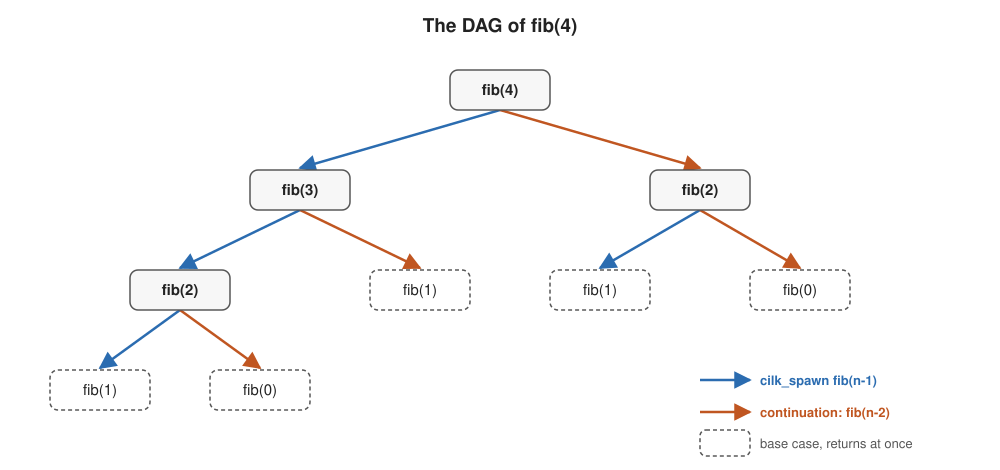
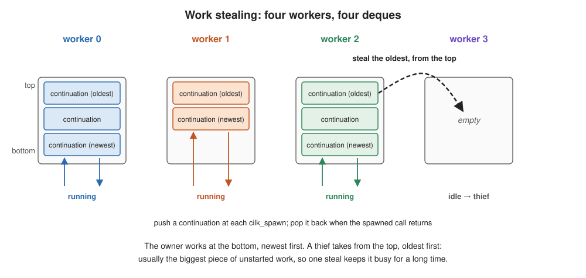
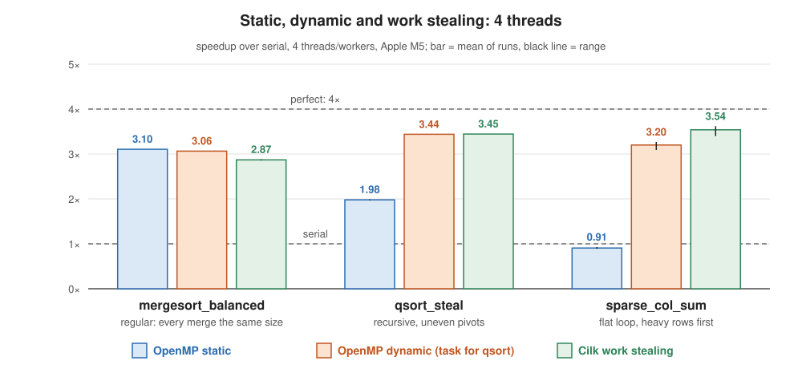
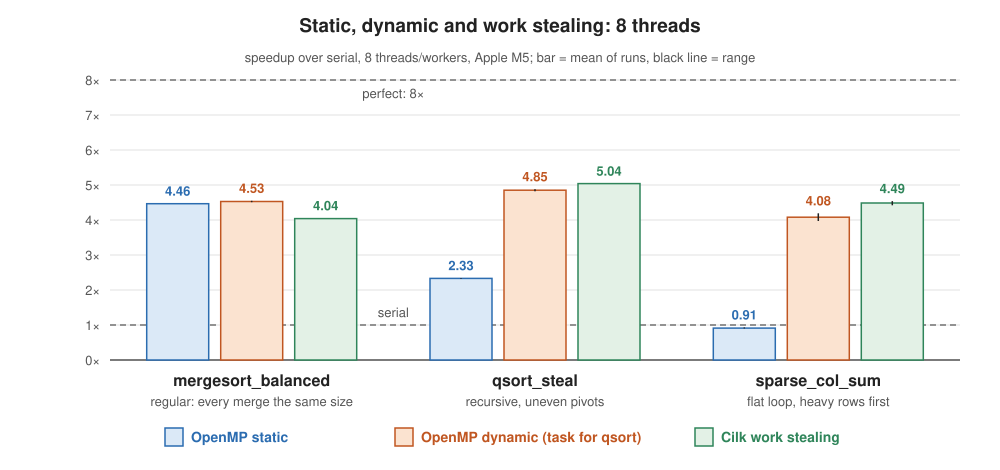

# Cilk

Learning goals:
  * Understand Cilk's model: you say what *may* run in parallel, and a scheduler
    decides what actually does
    * `cilk_spawn` and `cilk_sync`, and the serial program left when you remove them
    * `cilk_for`, a parallel loop built from spawns
  * Reason about a parallel program before running it, with work and span
    * the computation as a DAG of strands
    * T₁, T∞, parallelism, and the bound T_P ≈ T₁/P + T∞
    * why a balanced tree of spawns has huge parallelism and a chain has almost none
  * Understand work stealing, the scheduler that runs Cilk programs
    * each worker's deque: the owner works at one end, thieves steal from the other
    * why stealing is cheap when nobody is idle, and fixes imbalance when someone is
  * Know when work stealing beats OpenMP's static and dynamic schedules, and
    when it doesn't
    * granularity: every spawn must buy enough work to pay for itself

(This content was generated by Claude Opus 5.5 based on prior lectures from
Randal Burns and edited by Randal Burns.)


# Examples

  * [examples/cilk/](../examples/cilk/README.cilk.md) — a guided tour in four stages; start with its README
    * [fib.c](../examples/cilk/fib.c) — `cilk_spawn` and `cilk_sync`
    * [fib_dag.html](../examples/cilk/fib_dag.html) — the `fib(4)` spawn–sync DAG, with its work and span
    * [work_span.md](../examples/cilk/work_span.md) — work, span and parallelism, worked out
    * [vector_add.c](../examples/cilk/vector_add.c) — `cilk_for`
    * [work_stealing.html](../examples/cilk/work_stealing.html) — the deques, and who takes from which end
    * [qsort_steal.c](../examples/cilk/qsort_steal.c) and [mergesort_balanced.c](../examples/cilk/mergesort_balanced.c) — irregular work, where stealing wins, and regular work, where static wins
    * [sparse_col_sum.c](../examples/cilk/sparse_col_sum.c) — Lecture 10's example, now with Cilk
    * [dynamic_vs_work_stealing.md](../examples/cilk/dynamic_vs_work_stealing.md) — where OpenMP's dynamic schedule competes with stealing

---

## Where this picks up

Lecture 10 divided loops among a team of threads, and you chose how:
`static` before the loop starts, `dynamic` as it runs. Two things were left
over.

  * **You had to choose.** The right schedule depends on whether the
    iterations and the cores are equal, which you often don't know when you
    write the code.
  * **Recursion was awkward.** OpenMP's `task` handles divide-and-conquer, but
    every task costs the runtime real bookkeeping, so tasks have to be large.

Cilk takes a different approach. You write the program as **fork and join**,
marking what *may* run in parallel, and leave the scheduling to the runtime.
One scheduler, **work stealing**, handles loops and recursion, equal work and
unequal work, fast cores and slow ones. This lecture is about that model, a way
to reason about it before you run anything, and the scheduler underneath.

As in Lecture 10, every example here has independent pieces of work that write
only their own results. Sharing variables between parallel strands, and Cilk's
**reducers** for doing it safely, belong to the later lecture on shared data.

---

## What Cilk is

[OpenCilk](https://www.opencilk.org) extends C and C++ with three keywords.

| keyword | meaning |
|---|---|
| `cilk_spawn f(x)` | the call to `f` **may** run in parallel with the code that follows it |
| `cilk_sync` | wait until every call this function spawned has returned |
| `cilk_for (...)` | a loop whose iterations **may** run in parallel |

The important word is **may**. The keywords describe what is allowed to run in
parallel, not what does. The scheduler decides at run time, depending on which
workers are idle.

Delete the three keywords, or compile without Cilk, and you get an ordinary
serial C program that computes the same answer: the **serial elision**. That
gives you the same incremental, serial-to-parallel workflow as OpenMP, and a
serial version to check the parallel one against.

```bash
~/opencilk/bin/clang -fopencilk -O3 program.c -o program
CILK_NWORKERS=8 ./program          # 8 workers; the default is every core
```

A **worker** is Cilk's word for a thread in its pool. The runtime creates its
workers once, one per core by default, and keeps them for the rest of the
program.

---

## `cilk_spawn` and `cilk_sync`: fork and join

```c
long fib(int n)
{
    if (n < 2)
        return n;
    long a = cilk_spawn fib(n - 1);   // may run in parallel ...
    long b = fib(n - 2);              // ... with this, the continuation
    cilk_sync;                        // wait for the spawned call
    return a + b;
}
```

  * `cilk_spawn fib(n - 1)` makes that call, and everything after it in this
    function, the **continuation**, eligible to run at the same time.
  * `fib(n - 2)` is part of the continuation.
  * `cilk_sync` waits for every call this function spawned. Only after it can
    `a` be read. Every function that spawns also syncs implicitly when it
    returns, so a function never returns while its children are still running.

Compare Lecture 10's OpenMP version: no `parallel` region, no `single`, no
`shared(a)`. The spawn is part of the function call, and the program starts
with its workers already running.

---

## The computation as a DAG

Every Cilk program run is a **directed acyclic graph** (DAG). A node is a
**strand**: a stretch of serial instructions with no spawn or sync in it. An
edge means "must finish before". A spawn forks one edge into two. A sync joins
edges back together.



At each node, the left child is the spawned call, `fib(n - 1)`, and the right
child is the parent's own continuation, `fib(n - 2)`. Each node's addition
waits at its sync for both.

[fib_dag.html](../examples/cilk/fib_dag.html) draws the full `fib(4)` DAG,
including the syncs. Any two strands with no path between them in the DAG may
run at the same time. That is all the parallelism there is, and no scheduler
can find more.

---

## Work and span

Two numbers, both read straight off the DAG, bound how fast any scheduler can
run the program.

  * **Work, T₁**: the total time of every strand, or the running time on
    **one** processor.
  * **Span, T∞**: the time of the **longest path** through the DAG, the
    critical path. With **infinitely many** processors, that path still has to
    run one strand after another.

From them:

  * **Parallelism = T₁ / T∞**: the most speedup the program can ever get. If
    the work is 100 times the span, more than about 100 processors can't help.
  * **Lower bounds on time with P processors:** T_P ≥ T₁ / P (P processors can
    do at most P strands at once) and T_P ≥ T∞ (the critical path can't be
    shortened).
  * **What a good scheduler achieves:** T_P ≈ T₁ / P + T∞. Cilk's work
    stealing provably does this, in expectation. When the parallelism is much
    larger than P, the T∞ term is negligible and the speedup is close to P.

For `fib(n)`, the work grows as Θ(φⁿ), about 1.6ⁿ, but the span grows only as
Θ(n), down one spine of the tree and back. So the parallelism, Θ(φⁿ / n),
becomes enormous for large n. [work_span.md](../examples/cilk/work_span.md)
counts both for `fib(4)`.

### The shape of the DAG decides the span

The same work can have very different span. Here are two ways to spawn n
independent pieces of work:

```c
// A chain: the parent spawns every piece itself, one after another.
for (long i = 0; i < n; i++)
    cilk_spawn work(i);
cilk_sync;

// A balanced tree: split the range in half, spawn one half, do the other.
void range(long lo, long hi)
{
    if (hi - lo == 1) { work(lo); return; }
    long mid = (lo + hi) / 2;
    cilk_spawn range(lo, mid);
    range(mid, hi);
    cilk_sync;
}
```

Both do the same work. But the chain's span is Θ(n): the spawns happen one
after another, in the parent, so the last piece can't start until the parent
has spawned all the others. The tree's span is Θ(log n): any piece is only
log₂ n splits from the root. With n = 1,000,000, that is a span of a million
steps against twenty.

**Shrink the span, and grow the work-to-span ratio.** That one rule covers
most of what makes a Cilk program parallel.

---

## `cilk_for`: a balanced tree, built for you

```c
cilk_for (long i = 0; i < n; i++)
    c[i] = a[i] + b[i];
```

`cilk_for` is the balanced tree above, written by the compiler. It halves the
index range recursively, spawning one half at each level. When a range is down
to the **grain size**, it runs those iterations as an ordinary serial loop.
The default grain is about n / 8P iterations, capped at 2,048. You can set it explicitly:

```c
#pragma cilk grainsize(256)
cilk_for (long i = 0; i < n; i++) ...
```

So a `cilk_for` has span Θ(log n), plus the time for one grain. Compare
OpenMP's `parallel for`: OpenMP divides the iterations among T threads, but
`cilk_for` creates a tree of pieces, and lets the scheduler decide which worker
runs each one.

---

## Work stealing

How do the pieces get to the workers? There is no central queue. Each worker
owns a **deque**, a double-ended queue of work that is ready to run but that
nobody has started.

  * **A spawn is cheap.** When a worker reaches `cilk_spawn f()`, it starts
    running `f` immediately, as an ordinary call, and pushes the
    **continuation**, the rest of its own function, onto the **bottom** of its
    deque. That costs a few times a function call, with no locks.
  * **The owner works at the bottom.** When `f` returns, the worker pops its
    continuation back off the bottom and carries on. If nobody stole it, the
    program ran exactly as the serial elision would, in the same order, with
    hot caches.
  * **Thieves take from the top.** A worker whose deque is empty picks another
    worker at random and **steals** the continuation at the top of its deque:
    the oldest one, nearest the root of the DAG, and usually the largest piece
    of unstarted work.



[work_stealing.html](../examples/cilk/work_stealing.html) draws it.

Three properties follow:

  * **No idle worker, no cost.** While every worker has work, nobody steals,
    and a spawn costs only a push and a pop on the worker's own deque. The
    scheduler does work only when a worker runs dry.
  * **Steals are rare.** A steal takes the oldest continuation, which holds a
    big share of the remaining work, so the thief stays busy for a long time.
    The expected number of steals is O(P · T∞), independent of the total work.
  * **Imbalance fixes itself.** A worker on a fast core, or one whose pieces
    turned out to be small, runs dry first and steals more. Nobody plans the
    balance; it falls out of who goes idle.

This is what gives T_P ≈ T₁/P + T∞.

### Why push the continuation, and not the child?

The other design is just as natural: push the spawned call onto the deque,
and let the parent carry on. That is **child stealing**, and it is what
OpenMP tasks and Intel's TBB do. Cilk does the opposite, **continuation
stealing**: run the child now, and leave the rest of the parent for a thief.

| | Child stealing (OpenMP `task`, TBB) | Continuation stealing (Cilk) |
|---|---|---|
| a spawn, when nobody steals | package the child as a task: copy its arguments, allocate, queue | an ordinary function call, plus a push and a pop |
| order of execution, when nobody steals | not the serial order | exactly the serial elision |
| deque for `for (i = 0; i < n; i++) spawn f(i);` | n tasks, before any of them runs | one continuation: the rest of the loop |
| memory on P workers | no bound | at most P times the serial program's stack |
| a parent that reaches the sync early | waits, or runs other tasks while it waits | never waits: the last worker to finish carries on |

The design follows Cilk's **work-first principle**: put the overhead on the
steal path, not the spawn path. Spawns happen in proportion to the work;
steals happen only O(P · T∞) times. Packaging the child costs something on
every spawn, whether or not anyone steals it. The continuation costs
something only when a thief actually takes it.

You can see the difference in the code you write. An OpenMP task may run
later, on another thread, so it works on copies of its variables, and its
result has to come back through a `shared` variable. A Cilk spawn is a call
that runs now, so `long a = cilk_spawn fib(n - 1);` just assigns the return
value. Only the continuation can move, and the runtime moves it.

### Granularity: every spawn has to pay for itself

A spawn is cheap, but not free: a push and a pop, plus a much larger cost on
the rare occasions when a continuation is stolen and moves to another core.
If a spawned call does only a few nanoseconds of work, that overhead dominates.

So real Cilk code stops spawning below a **cutoff** and runs serially from
there, just as `cilk_for` stops at its grain size.
[qsort_steal.c](../examples/cilk/qsort_steal.c), for example, stops spawning
below 8,192 elements. The cutoff is the same trade-off as Lecture 10's chunk
size: small enough to leave many pieces for balancing, large enough that each
piece is much longer than its overhead.

---

## Stealing, static and dynamic: who wins?

Lecture 10 gave OpenMP two schedules. Work stealing is a third way to hand out
work, and each one wins somewhere.

| | when work is assigned | how | overhead |
|---|---|---|---|
| OpenMP `static` | before the loop | one fixed block per thread | none during the loop |
| OpenMP `dynamic` | during the loop | one shared counter; take the next chunk | an atomic per chunk, all on one variable |
| Cilk | during the run | P private deques; steal when idle | a push and pop per spawn; a steal only when idle |

Measured results from [examples/cilk/](../examples/cilk/README.cilk.md), with
4 threads or workers on an Apple M5, which has 4 performance cores:



| example | the work | static | dynamic | Cilk |
|---|---|---|---|---|
| [mergesort_balanced.c](../examples/cilk/mergesort_balanced.c) | perfectly regular: every merge in a pass is the same size | **3.10×** | 3.06× | 2.87× |
| [qsort_steal.c](../examples/cilk/qsort_steal.c) | recursive and irregular: pivots split unevenly | 1.98× | 3.44× (`task`) | **3.45×** |
| [sparse_col_sum.c](../examples/cilk/sparse_col_sum.c) | a flat loop, severely imbalanced | 0.91× | 3.20× | **3.54×** |

The static quicksort partitions level by level until there is one range per
thread, then gives each thread its range. Uneven pivots leave the ranges
unequal, and nothing moves work to an idle thread. OpenMP's `dynamic` can't
express the recursion, so its column is `task`.

What decides it:

  * **Regular work on equal cores: static.** There is nothing to rebalance, so
    any run-time scheduler pays its overhead for nothing. Static also keeps each
    thread on the same block, which is best for the caches.
  * **Recursive work: Cilk or `task`.** OpenMP's `dynamic` can't express
    recursion at all, and static can only guess the split in advance.
    OpenMP's `task` can, but every task is allocated and queued, while a Cilk
    spawn is a push onto a private deque. `qsort_steal` stops spawning below
    8,192 elements, so its tasks are big enough that the difference barely
    shows on 4 cores. The finer the tasks, the bigger Cilk's lead.
  * **A flat loop with uneven work, or uneven cores: dynamic or Cilk.** Both
    rebalance as they run, and they are often close.
    [dynamic_vs_work_stealing.md](../examples/cilk/dynamic_vs_work_stealing.md)
    compares them. Dynamic's single counter becomes a bottleneck with many
    threads or very small chunks; Cilk's private deques don't. But dynamic is a
    one-word change to an OpenMP loop. On a short loop, remember Lecture 10's
    cost of a parallel region: on macOS, OpenMP's sleeping threads add about
    16 µs to every region. With its threads kept awake, `dynamic` matched or
    beat Cilk on a flat loop in our measurements.

### Unequal cores

The M5 has 4 performance cores and 6 slower efficiency cores. With 8 threads,
at least four of them have to run on efficiency cores, and the same examples
change:



| example | static | dynamic | Cilk |
|---|---|---|---|
| [mergesort_balanced.c](../examples/cilk/mergesort_balanced.c) | 4.46× | **4.53×** | 4.04× |
| [qsort_steal.c](../examples/cilk/qsort_steal.c) | 2.33× | 4.85× (`task`) | **5.04×** |
| [sparse_col_sum.c](../examples/cilk/sparse_col_sum.c) | 0.91× | 4.08× | **4.49×** |

  * **Twice the threads is not twice the speed.** Going from 4 threads to 8
    raises the best speedups by 1.3–1.5×, not 2×: the four new threads run on
    slower cores.
  * **Static loses even on regular work.** Static gives every thread an equal
    block, which is equal *work*, but not equal *time* when some cores are
    slower. The threads on performance cores finish first and wait. On
    `mergesort_balanced`, static led with 4 threads (3.10× vs. 3.06×); with 8,
    `dynamic` overtakes it (4.53× vs. 4.46×), because a fast thread simply
    takes more chunks.
  * **The run-time schedulers don't care why the work is uneven.** Uneven
    work and uneven cores look the same to `dynamic` and to work stealing:
    a thread that runs out of work takes more, whatever the reason.

---

## What to carry forward

| | OpenMP | Cilk |
|---|---|---|
| you write | directives on loops and blocks | `cilk_spawn`, `cilk_sync`, `cilk_for` |
| a parallel loop | `parallel for`: T threads, one share each | `cilk_for`: a balanced tree of spawns, Θ(log n) span |
| recursion | `task` / `taskwait`, each task allocated and queued | `cilk_spawn`: about the cost of a call, unless stolen |
| who balances the work | you, by choosing a schedule and a chunk | the scheduler, by stealing |
| best at | regular loops (`static`); flat uneven loops (`dynamic`) | recursion and irregular work; uneven cores |

And two ideas that apply to both:

  * **Work and span** tell you how much parallelism a program has before you run
    it. No scheduler can exceed T₁ / T∞, and a good one gets close to
    T₁/P + T∞.
  * **Granularity** decides whether you get it. Every piece of parallel work,
    whether a chunk, a task or a spawn, has to be much larger than the cost of
    handing it out.

## On Your Own

Work through the tour in [examples/cilk/README.cilk.md](../examples/cilk/README.cilk.md).
Build everything with `make` in `examples/cilk/`. While you do:

  * Count the work and span of `fib(5)` the way
    [work_span.md](../examples/cilk/work_span.md) does for `fib(4)`. What is
    its parallelism?
  * Run [fib.c](../examples/cilk/fib.c) at n = 40 with `CILK_NWORKERS` set to
    1, 2, 4 and every core. Then add a cutoff, below which `fib` recurses
    without spawning, and run it again. How much faster is it on one worker?
    On every core?
  * Run [qsort_steal.c](../examples/cilk/qsort_steal.c) with cutoffs of 128,
    8,192 and 1,000,000 (its second argument). How do Cilk and OpenMP `task`
    change as the tasks get finer?
