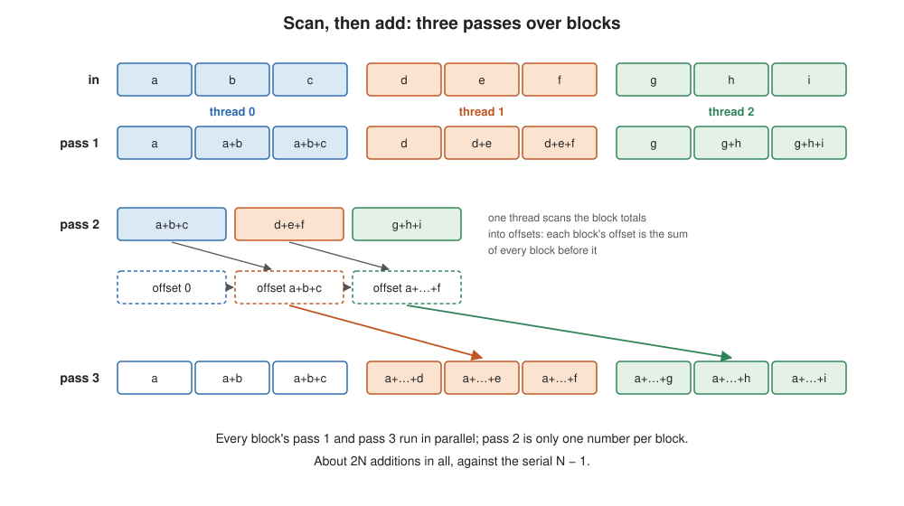
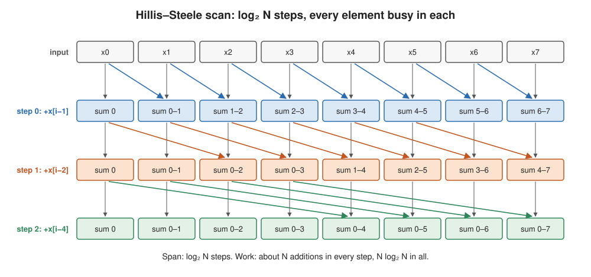

# Prefix Sum: When the Parallel Algorithm Isn't the Serial One

Learning goals:
  * Recognize a loop that no pragma can parallelize
    * a loop-carried dependence makes the computation a chain: span N,
      parallelism 1
    * adding `parallel for` to it gives wrong answers, and nothing warns you
  * Restructure a computation for parallelism, instead of annotating the
    serial version
    * associativity lets the sums be regrouped into blocks
    * the parallel algorithm does **more work** than the serial one, and is
      slower on one core
  * Reason about what limits each version, and predict when each one wins
    * the serial loop: a chain of dependent adds
    * the parallel versions: the chains in each block, then memory bandwidth
    * count bytes, not just operations
  * Know the tree algorithms (Hillis–Steele and Blelloch) and why a CPU with a
    few cores uses blocks instead

(This content was generated by Claude Opus 5.5 based on prior lectures from
Randal Burns and edited by Randal Burns.)


# Examples

  * [examples/prefix_sum/](../examples/prefix_sum/README.prefix_sum.md) — the algorithm, measured results, and what limits them
    * [omp_prefix_sum.c](../examples/prefix_sum/omp_prefix_sum.c) — serial, and two parallel versions in OpenMP: scan-then-add and reduce-then-scan
    * [cilk_prefix_sum.c](../examples/prefix_sum/cilk_prefix_sum.c) — scan-then-add in Cilk

---

## Where this picks up

Lectures 10 and 11 parallelized loops by adding a keyword: `#pragma omp
parallel for`, or `cilk_for`. That works when the iterations are independent,
so that each one writes only its own results and reads nothing another
iteration writes.

Many important loops aren't like that. This lecture is about one of them, the
**prefix sum**, and its lesson applies far beyond it: **the best parallel
program often isn't the serial program with directives added.** It is a
different algorithm, designed for parallel hardware. It may do more work than
the serial one, and be slower on one core, and still be the right choice.

---

## The problem

Given an array `in[0..N-1]`, the **inclusive prefix sum**, or **scan**, is the
array of running totals:

```
out[0] = in[0]
out[1] = in[0] + in[1]
out[2] = in[0] + in[1] + in[2]
  ...
out[i] = in[0] + in[1] + ... + in[i]
```

Prefix sums turn up everywhere in parallel programming. They compute where
each thread should write its output (stream compaction: keep the elements that
pass a test, with no gaps), where each bucket starts in a radix sort, how to
split work evenly, and cumulative histograms and distributions.

The serial code is one line:

```c
out[0] = in[0];
for (long i = 1; i < N; i++)
    out[i] = out[i-1] + in[i];
```

It does N − 1 additions and one pass over memory: read `in`, write `out`.

---

## Why a pragma can't parallelize it

Every iteration reads `out[i-1]`, which the previous iteration wrote. This is a
**loop-carried dependence**, and it makes the computation's DAG (Lecture 11) a
single chain:

![The serial prefix sum is a chain: each out[i] needs out[i-1] and in[i], so every addition waits for the one before it](images/prefix_chain.svg)

Its work is N additions and its span is also N, so its parallelism, T₁/T∞, is
**1**. No scheduler can run it faster on more cores, because there is never
more than one addition ready to run.

Add the pragma anyway and you get wrong answers, not an error:

```c
#pragma omp parallel for          // WRONG
for (long i = 1; i < N; i++)
    out[i] = out[i-1] + in[i];
```

Thread 1 starts its block at `out[N/4]` while thread 0 is still computing
`out[N/4 - 1]`, so thread 1 reads a value that hasn't been written yet. As
Lecture 10 said, the compiler doesn't check that iterations are independent.

What does limit the serial loop? Not memory. It moves two arrays of 800 MB in
about 51 ms on an Apple M5, which is only 31 GB/s, a quarter of what the memory
system can deliver. The limit is the chain itself: each addition waits for the
one before it, about 0.5 ns per element.

---

## The way out: regroup the additions

Addition is **associative**: (a + b) + c = a + (b + c). So a prefix can be
regrouped. For an element in block k:

```
out[i] = (sum of every block before k)  +  (sum of block k up to i)
          └──── one number per block ──┘    └── local to block k ──┘
```

The second part needs only block k's own elements, so every block can compute
it at the same time. The first part is one number per block, which a quick
serial pass over P block totals can produce. That gives a parallel algorithm in
three passes.

**Scan, then add.** One contiguous block per thread:

  1. **Pass 1 (parallel):** each thread scans its own block of `in` into `out`,
     and saves its block's total.
  2. **Pass 2 (serial):** scan the P totals into offsets. Block k's offset is
     the sum of every block before it.
  3. **Pass 3 (parallel):** each thread adds its block's offset to every element
     of its block of `out`.



Count the cost:

  * **Work:** about **2N** additions, N in pass 1 and N in pass 3, against the
    serial N − 1. **The parallel algorithm does twice the arithmetic.**
  * **Span:** about N/P + P + N/P, two passes over one block plus the serial
    pass over the totals. The parallelism is about P/2, enough to use P cores.
  * **Memory traffic:** pass 1 reads `in` and writes `out`; pass 3 reads `out`
    and writes it again. That is **four** passes over an 800 MB array, against
    serial's two.

The chain hasn't gone away. Each thread's pass 1 is still a chain of N/P
dependent additions. It has been cut into P chains that run side by side.

**Floating-point note.** Floating-point addition is only *approximately*
associative: regrouping changes the rounding. The parallel result differs from
the serial one in the last few bits. In this example the relative difference is
below 10⁻¹⁰. That is the price of regrouping, and every parallel sum pays it.

---

## A second design: reduce, then scan

Scan-then-add writes `out` twice. Reorder the work and it writes `out` once:

  1. **Pass 1 (parallel):** each thread only **sums** its block of `in`, and
     writes nothing.
  2. **Pass 2 (serial):** offsets from the sums, as before.
  3. **Pass 3 (parallel):** each thread **scans** its block of `in` into `out`,
     starting from its offset.

```c
// pass 1: a sum, not a scan
double s = 0.0;
#pragma omp simd reduction(+:s)
for (long i = start; i < end; i++)
    s += in[i];
block_sum[tid] = s;

// pass 3: scan the block, starting from its offset
double s = offset[tid];
for (long i = start; i < end; i++) {
    s += in[i];
    out[i] = s;
}
```

It reads `in` twice and writes `out` once: **three** passes over 800 MB instead
of four. It also uses a fact about sums that scans don't share. A sum only
needs the total, so it can be added up in any order: in vector registers, with
several partial sums at once (`#pragma omp simd reduction`). Pass 1 is no longer
a chain at all; it streams memory as fast as the core can read.

Which design is better? It depends on what limits the program, and that depends
on how many cores there are.

---

## Measured: who wins, and why

Apple M5 (4 performance and 6 efficiency cores), N = 100,000,000 doubles,
fastest of four trials, two runs each, every result checked against serial
([full results](../examples/prefix_sum/README.prefix_sum.md)):

| threads | serial | scan, then add | reduce, then scan |
|---|---|---|---|
| 1 | 51 ms | 51 ms (1.0×) | 62 ms (**0.83×**) |
| 2 | 51 ms | 33 ms (1.6×) | 36 ms (1.4×) |
| 4 | 51 ms | 22.5–24.5 ms (2.1–2.3×) | 23–24 ms (2.2×) |
| 10 | 52–54 ms | 24–25 ms (2.1×) | **19.4–20.3 ms (2.6×)** |

Read it row by row.

  * **One thread: the parallel algorithm is a worse serial algorithm.**
    Reduce-then-scan passes over `in` twice, so on one core it is 20% *slower*
    than the plain loop. (Scan-then-add ties serial only because thread 0 has
    no offset to add in pass 3.) A parallel algorithm that does more work has
    to earn it back with cores.
  * **A few threads: the chains dominate.** Each thread still has a chain of
    N/P dependent adds: in pass 1 for scan-then-add, in pass 3 for
    reduce-then-scan. With 2 or 4 threads those chains are most of the time,
    and the two designs are close.
  * **Ten threads: memory bandwidth dominates.** Count the bytes.
    Scan-then-add moves 4 × 800 MB = 3.2 GB in about 24 ms. Reduce-then-scan
    moves 2.4 GB in about 20 ms. Both are about 120–130 GB/s, the same rate an
    OpenMP dot product reaches on this machine, which is close to the most the
    memory system can deliver. At that point the program that moves fewer bytes
    wins, so reduce-then-scan pulls ahead.

**Why not 10×?** Not Amdahl's law: the serial pass 2 is 10 additions out of
200 million. The limit is that the parallel algorithm moves more data than the
serial one, through a memory system all the cores share. Once that system is
saturated, more cores add nothing. The serial loop used a quarter of the
bandwidth. The parallel ones use all of it, and that is worth only 2–2.6×.

(The Cilk version of scan-then-add in the example directory reaches about the
same speedups as OpenMP, 1.6–2.3×, but only after a one-line change. Written exactly like
the serial loop, `out[i] = out[i-1] + in[i]`, its pass 1 compiled to code that
reloaded `out[i-1]` from memory on every iteration inside the `cilk_for`, and
it ran 4.3× slower than serial on one worker. Carrying the running sum in a
local variable fixed it. The same source line can compile differently inside a
parallel construct: when a parallel version is slow, look at the code the
compiler generated before blaming the scheduler. See the
[example's README](../examples/prefix_sum/README.prefix_sum.md).)

---

## Tree algorithms: more parallelism, more work

Block scans give parallelism of about P: enough for 10 cores, not for 10,000
GPU threads. For massive parallelism there are scans built like Lecture 11's
balanced spawn tree, with logarithmic span.

**Hillis–Steele.** In step d (d = 0, 1, 2, ...), every element adds the element
2ᵈ positions to its left, all at once:



Span is log₂ N, but every step touches nearly every element, so the work is
about N log₂ N: **20 times** the serial work for a million elements.

**Blelloch** (work-efficient). An **up-sweep** builds a tree of partial sums,
like a reduction, and a **down-sweep** pushes prefixes back down the tree.
Work is about 2N, span about 2 log₂ N. That is the same factor-of-two extra
work as the block scan, with far more parallelism.

| algorithm | work | span | parallelism |
|---|---|---|---|
| serial loop | N | N | 1 |
| block scan, P blocks | ≈ 2N | ≈ 2N/P + P | ≈ P/2 |
| Hillis–Steele | ≈ N log₂ N | log₂ N | ≈ N |
| Blelloch | ≈ 2N | ≈ 2 log₂ N | ≈ N / log₂ N |

Which to use depends on the machine. A GPU with thousands of threads needs the
parallelism of a tree, and uses Blelloch-style scans. A CPU with 10 cores
needs only about 10-way parallelism, and gets it from blocks. Each block is
then a simple, sequential, cache-friendly loop, and the whole scan makes as few
passes over memory as possible. As the measurements showed, on a CPU the passes
over memory, not the additions, decide the speed.

---

## The lesson

The serial prefix sum is the best serial algorithm: one pass, N − 1 additions.
No amount of annotation turns it into a parallel one, because its structure,
one long chain, is the problem.

The parallel versions start from a property of the *problem*, associativity,
not from the serial *code*. They do more work, they are slower on one core,
and the best one depends on what limits the machine: dependent adds with a
few cores, bytes moved with many. Designing them means asking:

  * **What is the span of the serial algorithm?** If it is N, look for a
    different algorithm rather than a different pragma.
  * **What property lets you regroup the work?** Here, associativity. For
    quicksort (Lecture 11's `qsort_steal.c`), the two sides of a partition are
    independent.
  * **How much extra work does the regrouping cost, and how many cores does it
    take to pay it back?**
  * **What will limit the parallel version?** Count both operations and bytes,
    and remember that the cores share the memory system.

## What to carry forward

| | serial loop | scan, then add | reduce, then scan |
|---|---|---|---|
| additions | N | ≈ 2N | ≈ 2N |
| passes over 800 MB | 2 | 4 | 3 |
| limited by | the chain of adds | chains (few cores), bandwidth (many) | chains (few cores), bandwidth (many) |
| best at | 1 core | 2–4 cores | many cores |

## On Your Own

Build the example (`make` in `examples/prefix_sum/`) and run
`./omp_prefix_sum 100000000 T` for T = 1, 2, 4, and every core on your machine.

  * For each version, divide the bytes it moves (2, 4 or 3 passes of 800 MB) by
    its time. At which thread count does each one stop speeding up? Compare its
    bandwidth then with what `examples/openmp/dot_product` reaches.
  * Remove `#pragma omp simd reduction(+:s)` from pass 1 of
    `prefix_omp_reduce_scan` and run again. Which thread counts change, and why?
  * Predict which version wins on the course machine (12 cores, 16 MB L3 per
    group of cores), then run it and check.
