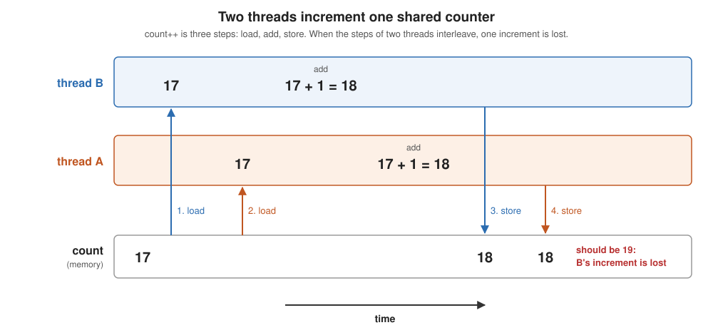

# Synchronization

Learning goals:
  * Run tasks on threads in Java
    * a thread: `Thread`, a `Runnable` lambda, `start()`, `join()`
    * good practice: submit tasks to a thread pool
    * `static` fields are shared; variables declared in a task are private
      to it
  * Explain why a shared increment gives the wrong answer
    * `count++` is load, add, store, and two threads can interleave them
    * race condition, critical section, thread safety
  * Name the ways to make it correct, and what each one is
    * a mutex: `synchronized`, `ReentrantLock`
    * an atomic operation: `AtomicLong`
    * a lock built from an atomic: a spin lock
    * avoid sharing: accumulate locally, combine once
  * Know what `volatile` does and doesn't do: visibility, not atomicity

(This content was generated by Claude Opus 5.5 based on prior lectures from
Randal Burns and edited by Randal Burns.)


# Examples

  * [examples/synchronization/](../examples/synchronization/README.synchronization.md) — one shared counter, incremented eight ways
    * [HelloThreads.java](../examples/synchronization/HelloThreads.java) — the mechanics of a Java thread
    * [HelloPool.java](../examples/synchronization/HelloPool.java) — tasks on a thread pool
    * [Race.java](../examples/synchronization/Race.java) — the wrong answer
    * [Synchronized.java](../examples/synchronization/Synchronized.java), [ExplicitLock.java](../examples/synchronization/ExplicitLock.java), [SpinLock.java](../examples/synchronization/SpinLock.java), [Atomic.java](../examples/synchronization/Atomic.java), [Local.java](../examples/synchronization/Local.java) — five right answers
    * [Volatile.java](../examples/synchronization/Volatile.java) — a fix that isn't
    * [WrongLock.java](../examples/synchronization/WrongLock.java) — `synchronized`, on the wrong lock
    * [SyncBench.java](../examples/synchronization/SyncBench.java) and [results.M5.md](../examples/synchronization/results.M5.md) — what each method costs, 2 threads to one per core, contended and with private work
    * [LockHog.java](../examples/synchronization/LockHog.java) — does one thread hog the lock? run lengths, and how many threads are really using a core

---

## Where this picks up

  * Lectures 10–12: OpenMP and Cilk, where threads work on separate data
  * Lecture 13: sharing a line between cores costs a transfer, and atomics
    and locks pay it in full
  * Now: threads that share on purpose, and how to keep them correct

## Java threads, the mechanics

  * code: [HelloThreads.java](../examples/synchronization/HelloThreads.java);
    run with `java HelloThreads.java`, no build step
  * a `Thread` runs a `Runnable`, the code to execute, written as a lambda:
    `new Thread(() -> ...)`
  * `t.start()` returns at once and runs the lambda in a new thread
  * `t.join()` waits for `t` to finish
  * this is what a thread pool is made of

## Thread pools: how to use threads

  * code: [HelloPool.java](../examples/synchronization/HelloPool.java); all
    the examples that follow are written this way
  * `Executors.newFixedThreadPool(n)` starts `n` threads once and reuses them
  * `pool.submit(() -> ...)` hands the pool a task; an idle thread runs it
  * in a try-with-resources block, `close()` waits for every task, like `join()`

    ```java
    try (ExecutorService pool = Executors.newFixedThreadPool(nthreads)) {
        for (int t = 0; t < nthreads; t++)
            pool.submit(() -> { for (int i = 0; i < N; i++) count++; });
    }
    ```

  * task vs unit of execution (Lecture 9): the lambda is the task, the pool
    thread is what runs it; HelloPool runs 8 tasks on 4 threads
  * scoping does what OpenMP's parallel block did:
    * a `static` field: one copy, shared by every task
    * a variable declared inside the lambda: private to that task

## Race Condition: a shared increment

  * a **race condition**: the result depends on the order in which threads
    happen to run
    * it arises when threads access shared data at the same time, at least
      one of them writes, and nothing orders the accesses
    * some orders give the right answer and some don't, so the bug comes and
      goes from run to run
  * code: [Race.java](../examples/synchronization/Race.java) — 4 tasks on 4
    threads, 1M increments each
  * 4,000,000 expected; 1–2.7M on an M5, and different on every run
  * `count++` is three steps, and two threads can interleave them:



This problem is known as a lost write and arises from an unsafe interleaving of reads/writes to memory.


  * each thread has its own registers, so between its load and its store a
    thread works on a private copy of `count`
  * the write is lost when another thread's load lands between one
    thread's load and its store; any order that keeps the three
    instructions of each increment together is correct
  * one instruction doesn't fix it: `add qword ptr [count], 1` still loads,
    adds and stores inside the core, and two cores can interleave those
    steps; `lock add` makes it atomic (see Atomics below)

Java provides many techniques to solve race conditions, and they have different
performance implications. The goal is to have code that is:

  * **thread safe**: code that is correct when many threads call it at once,
    in any interleaving, with no synchronization added by the caller

One approach to thread safety is:

  * **mutual exclusion**: at most one thread at a time runs a given piece of
    code; any other thread that arrives waits until it is done

## Critical Section

  * a **critical section**: implements mutual exclusion for a block of code (or a function)
    * in Java, the keyword `synchronized` defines a critical section:

    ```java
    synchronized (lock) {     // wait until no other thread holds lock
        count++;              // the critical section
    }                         // release lock: the next thread may enter
    ```

  * code: [Synchronized.java](../examples/synchronization/Synchronized.java)
    — 4,000,000 every run
  
  * memory guarantees: a critical section orders memory, not only code
    * everything a thread writes inside the block is visible to the next
      thread that enters a block on the same lock
    * the compiler and the processor may not move the loads and
      stores out of the block

  * scope: two blocks exclude each other only if they use the *same* lock
    object, so the lock's scope must match the scope of the data

    | data | lock | form |
    |---|---|---|
    | one copy per class (`static`) | the class, or a `static` lock object | `static synchronized`, or `synchronized (lock)` |
    | one copy per object (a field) | that object, or a lock it owns | `synchronized` method, or `synchronized (this)` |

    * the classic bug is a mismatch: each task has its own `Counter`, so each
      takes a different lock and no task ever waits
      ([WrongLock.java](../examples/synchronization/WrongLock.java): about 1M
      of 4M on an M5)

      ```java
      class Counter {
          static long count = 0;                    // one copy, for the class
          synchronized void increment() { count++; }  // one lock, per object
      }
      ```

    * the fix is one word: `static synchronized void increment()` locks the
      class, which every task shares
    * scope also sets how much runs serially: with one lock per object, tasks
      that use different objects don't wait for each other; with one lock
      for the class, all of them take turns

The Java runtime chooses between several possible implementations at runtime. It's complex. Let's explore the options:

## locks

A critical section can be implemented with explicit `lock()`/`unlock()` call.

  * `ReentrantLock` ([ExplicitLock.java](../examples/synchronization/ExplicitLock.java))
    * the same mutex as an object: `lock()`, then `unlock()` in a `finally`
    * more control: `tryLock()`, timeouts, fairness, lock and unlock in
      different methods
    * more responsibility: forget the `unlock()` and every other thread waits
      forever
  * "reentrant": the thread holding the lock can acquire it again without
    deadlocking itself (true of `synchronized` too)

## Atomics: the critical section as one instruction

  * code: [Atomic.java](../examples/synchronization/Atomic.java) —
    `AtomicLong.incrementAndGet()`
  * the hardware does load, add, store as one step (`lock xadd` on x86,
    `ldadd` on ARM), so no other thread can come in between
  * no lock, no waiting thread, but it works only when the critical section is
    one operation the hardware has: add, exchange, compare-and-set (CAS)
  * an atomic still moves the cache line, and pays for the whole
    trip

## Building a spin lock from an atomic

  * code: [SpinLock.java](../examples/synchronization/SpinLock.java)
  * a lock is a shared flag: to acquire it, see `false` and write `true` in
    *one* step, or two threads could both get in
  * `compareAndSet(false, true)` is that step; if it fails, try again
  * `Thread.onSpinWait()` is the pause hint from Lecture 13
  * `synchronized` and `ReentrantLock` add one thing: a thread that waits too
    long asks the OS to sleep until the lock is free
    * spin: fast handoff, but the waiter burns a core
    * sleep: the waiter frees the core, but the wakeup goes through the OS

## The best synchronization is none

  * code: [Local.java](../examples/synchronization/Local.java)
  * count in a variable local to the task; one synchronized add per task at
    the end
  * analagous to OpenMP's `reduction` and Cilk's reducers
  * it applies when the threads' updates can be combined at the end; a shared
    queue or a bank balance still needs a lock

## How does Java implement synchronized?

  * every acquire goes through up to three stages, each a fallback for the
    one before:
    1. try a CAS to take the lock; if it is free, that's all it costs, and
       the release is one store
    2. if the lock is taken, spin briefly, in case it is about to be
       released
    3. if it is still taken, ask the OS to sleep until it is free; the
       wakeup goes through the OS
  * the first time a lock is contended, the JVM gives it a monitor, an
    object that holds the owner and the queue of sleeping threads; the lock
    keeps it until it goes quiet
  * the JIT can also remove a lock it proves no other thread can use, or
    merge adjacent blocks on the same lock into one
  
  The cost of a critical section depends on how contended it is: one
    atomic when the lock is free, a trip through the OS when it isn't


### Performance

  * code: [SyncBench.java](../examples/synchronization/SyncBench.java) —
    every method, 2 threads to one per core, in two benchmarks:
    * `contended`: back-to-back increments, the worst case
    * `work`: ~760 ns of private work between increments, the common case
  * results: [results.M5.md](../examples/synchronization/results.M5.md),
    ns per increment on an Apple M5 (4 performance + 6 efficiency cores)
  * with little contention, every method costs the same: up to 4 threads in
    `work`, all six take the same time, and it falls as threads are added
  * under contention, the methods separate
    * `AtomicLong`: 4 ns with 2 threads, 30 ns with 10: every increment
      moves the line
    * the locks: 100–240 ns per increment for `synchronized` and the spin
      lock; in `work`, from 5 threads on they get *slower* as threads are
      added
    * `LongAdder` and Local get faster with more threads: no shared variable
  * `ReentrantLock` is fast under contention (~5 ns) because the lock stays
    with one thread: tested in
    [LockHog.java](../examples/synchronization/LockHog.java)
    * from 4 to 10 threads, one thread makes 230–570 increments in a row
      (`synchronized`: 1–4), and about 2 of 10 threads are using a core
    * the fair version, `new ReentrantLock(true)`, hands off on every
      increment and takes ~2,500 ns, 400× slower
    * with private work between increments, the long runs disappear

## What to carry forward

  * a critical section is the problem; a mutex or an atomic is the mechanism
  * every lock is built on an atomic instruction
  * all of them are correct, so the question becomes what they cost: next, we
    measure each one as the number of threads grows

## On Your Own

  * run `./run.sh` and `./run.sh 8` in
    [examples/synchronization/](../examples/synchronization/); do the wrong
    totals change from run to run? with the thread count?
  * make `Race.java` correct with a `static synchronized` method
  * what goes wrong in `Synchronized.java` if each task locks its own
    `new Object()`?
