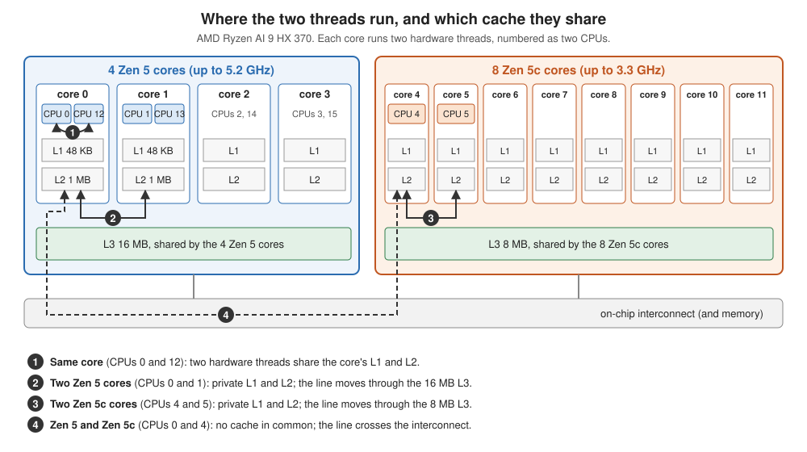
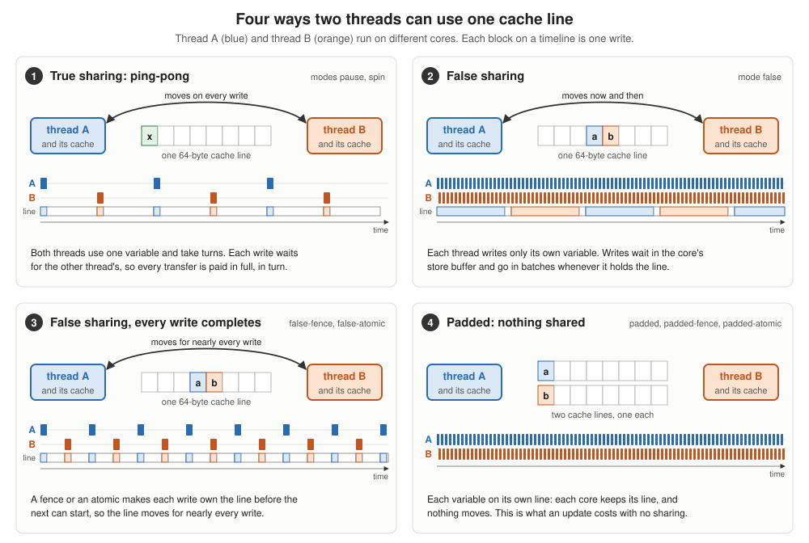
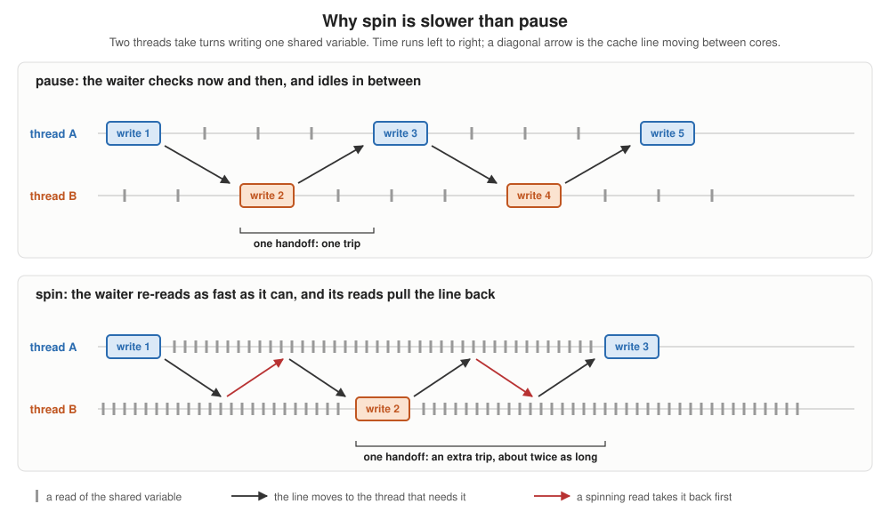

# Sharing data between threads

What does it cost when two threads use the same data? This example measures it
on one machine, for two kinds of sharing and four placements of the threads.

`sharing.cpp` runs two threads as Cilk workers. `cilk_spawn` runs the first on
the current worker, and the second worker steals the continuation and runs the
second. Each thread pins itself to a CPU you choose, so the same program
measures every placement.

```
make the binary:  ~/opencilk/bin/clang++ -fopencilk -O3 -std=c++17 sharing.cpp -o sharing
one measurement:  CILK_NWORKERS=2 ./sharing 0 1 false
everything:       ./run.sh
```

It runs on Linux only: it pins threads with `sched_setaffinity`, which macOS
doesn't have. For an Apple M5, `sharing.M5.cpp` places the threads by QoS
instead; its results are in [results.M5.md](results.M5.md).

## Where the threads run



On a Ryzen AI 9 HX 370, the four placements differ in which cache the two
threads have in common, and so in how far a cache line travels between them:

| pair | CPUs | what the two threads share |
|---|---|---|
| 1. same core | 0 and 12 | the core's L1 and L2 (two hardware threads of one Zen 5 core) |
| 2. two Zen 5 cores | 0 and 1 | the 16 MB L3 of the Zen 5 cores |
| 3. two Zen 5c cores | 4 and 5 | the 8 MB L3 of the Zen 5c cores |
| 4. one of each | 0 and 4 | nothing: the line crosses the on-chip interconnect |

## What the threads do



The third argument picks the method:

| mode | what each thread does | what it measures |
|---|---|---|
| `pause` | takes turns with the other thread writing one shared atomic variable, alone on its cache line | **true sharing**: the latency of passing an update from one core to the other |
| `spin` | the same, but the waiting thread re-reads the variable as fast as it can | the cost of waiting impatiently |
| `false` | increments its own `volatile` variable; the two variables share one cache line | **false sharing** with ordinary writes |
| `padded` | the same, each variable on its own line | the baseline: an update with nothing shared |
| `false-fence` | `false`, with a full memory fence after each increment | false sharing when each write must complete before the next |
| `padded-fence` | the same, each variable on its own line | the fence's own cost |
| `false-atomic` | increments its own `std::atomic<long>` with `fetch_add`; both in one line | false sharing with atomic updates |
| `padded-atomic` | the same, each variable on its own line | the atomic's own cost |

`pause` and `spin` report nanoseconds per *handoff*: one write, after which the
other thread writes next. The other modes report nanoseconds per *increment* by
one thread, while the other thread does its own increments at the same time.
Every number is the fastest of 7 runs, and both threads start together.

## Results

Measured 2026-10-26 on mains power, three runs of `run.sh`: the median of the
three, with the range where it is wider than a few percent. Each run's number is
the fastest of 7 trials. Two Zen 5 cores busy ran at 4.7 GHz, a Zen 5c core at
3.3 GHz.

| mode | 1. same core | 2. two Zen 5 | 3. two Zen 5c | 4. Zen 5 + Zen 5c |
|---|---|---|---|---|
| `pause` (ns per handoff) | 11.9 | 18.9 | 29.1 | 171.1 (119.7–171.3) |
| `spin` (ns per handoff) | 31.8 (29.9–33.2) | 47.3 (38.2–52.8) | 76.3 | 161.6 (108.0–171.1) |
| `false` (ns per increment) | 1.1 | 1.1 | 1.1 | 0.8 |
| `padded` | 0.2 | 0.2 | 0.3 | 0.3 |
| `false-fence` | 18.5 | 32.4 | 53.3 | 65.7 |
| `padded-fence` | 17.9 | 16.5 | 25.5 | 25.4 |
| `false-atomic` | 13.2 | 11.3 | 17.0 | 15.1 |
| `padded-atomic` | 4.4 | 3.8 | 6.0 | 6.0 |

### What the numbers say

**True sharing costs a full trip, every time, and the trip depends on
distance.** In `pause`, each write must wait for the other thread's, so nothing
overlaps: every handoff pays the whole journey of the cache line. Between the
two hardware threads of one core, which share its L1, a handoff takes 12 ns.
Between two Zen 5 cores, through their shared L3, 19 ns; between two Zen 5c
cores, through theirs, 29 ns. Between a Zen 5 and a Zen 5c core it takes about
170 ns, nine times as long as within the Zen 5 cores, because the two kinds of
core have separate L3 caches and share nothing closer than the interconnect.

**How a thread waits matters.** In `spin`, the waiting thread re-reads the
variable as fast as it can. Each read pulls the cache line back toward the
waiter just as the other thread needs it to write, so handoffs take 2.5 to 2.7
times as long as with `pause`, whose spin-wait hint makes the waiter poll
gently. Across the two clusters the trip itself dominates, and the two come out
about the same.



For a picture of false sharing, packed counters against padded ones, see the
[False Sharing](https://claude.ai/artifact/2Y16D2StfxCmXQKdZ24x7Q) explainer.

**Plain false sharing is cheap here.** In `false`, neither thread ever reads the
other's variable, and an increment costs about 1 ns, three to five times the
0.2-0.3 ns it costs with the variables apart. It is not 20 to 170 ns, because an
ordinary write doesn't wait for the cache line: it goes into the core's store
buffer, and the core carries on. Whenever the core gets the line, it commits a
whole batch of buffered writes at once, so the cost of each transfer is shared
by many increments. With more threads on the line, each core gets it back less
often, and the penalty grows: `examples/deprecated/false_sharing` uses 8 threads.

**False sharing hurts when each update must complete.** Make each write finish
before the next one starts, with a fence after it (`false-fence`) or an atomic
read-modify-write (`false-atomic`), and the line has to move for nearly every
update. Then the cost grows with distance. A fenced increment costs about the
same on one core as with no sharing at all (18.5 against 17.9 ns, since both
threads use the same L1), 16 ns more between two Zen 5 cores, 28 ns more
between two Zen 5c cores, and 40 ns more across the two clusters. With atomics,
false sharing costs two and a half to three times as much as padding. Locks and atomic
counters are updates of exactly this kind.

### Measuring at full clock

A core that only waits doesn't speed up. Both threads in `pause` spend nearly
all their time on the spin-wait hint, and a core doing that stays at about
3.6 GHz instead of boosting to 5.1 GHz. Measured that way, a handoff on one core
took 25.7 ns after an idle pause and 17.9 ns when other work had boosted the core
just before, and the result depended on what had run earlier. So before timing,
each thread now spins for a second on a loop that keeps its core busy (four
independent integer chains), and every number above is at full clock. A real
program whose threads mostly wait for each other would run at the lower clock.

### Not yet explained

Across the two clusters, one run in three of `pause` and of `spin` gave about
110-120 ns per handoff instead of about 170 ns. The other modes on the same pair
were steady. One guess is the clock of the on-chip interconnect, which the
operating system doesn't control, but this hasn't been checked.

## Caveats

* "Same core" means the two hardware threads (SMT) of one core, which share
  its L1 and L2. Two threads taking turns on a single CPU would measure context
  switches instead.
* The CPU numbers are for the Ryzen AI 9 HX 370. On another machine, read
  `/sys/devices/system/cpu/cpu*/topology/` and `cache/index*/shared_cpu_list`
  to find pairs that share an L1, an L3, or nothing.
* `make_methods_figure.py` draws `sharing_methods.svg`. `sharing_topology.svg`
  is drawn by hand.
