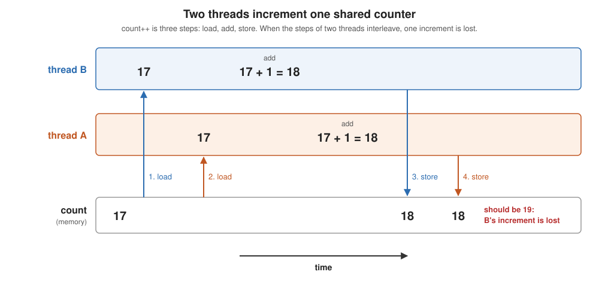

# Synchronizing a shared increment

Every program runs as a single file, with no build step (JDK 11 or later):

```
java Race.java          4 threads (the default)
java Race.java 8        8 threads
./run.sh 8              every version, 8 threads
```

## Java threads and thread pools

[HelloThreads.java](HelloThreads.java) shows what a thread is:

  * a `Thread` runs a `Runnable`, the code to execute, written as a lambda:
    `new Thread(() -> ...)`
  * `start()` returns at once and runs the lambda in a new thread
  * `join()` waits for the thread to finish

[HelloPool.java](HelloPool.java) shows how to use threads, and every other
program here is written this way:

  * `Executors.newFixedThreadPool(n)` starts `n` threads once and reuses them
  * `pool.submit(() -> ...)` hands the pool a **task**; an idle thread takes it
    and runs it
  * the pool goes in a try-with-resources block: `close()`, at the end of the
    block, waits for every task to finish
  * the task is the work, the thread is the unit of execution that runs it
    (Lecture 9's vocabulary); HelloPool runs 8 tasks on 4 threads

What the tasks share:

  * a `static` field has one copy, shared by every task
  * a variable declared inside the lambda is private to that task

## The problem

`count++` is three steps: load `count`, add 1, store it back. Two threads can
interleave them:



The result depends on the order the threads happened to run in: a **race
condition**. The lines that must not interleave form a **critical section**.
To synchronize is to make sure that only one thread at a time is in it.

## The versions

| program | how it increments | correct? |
|---|---|---|
| [Race.java](Race.java) | `count++` | no |
| [Volatile.java](Volatile.java) | `count++` on a `volatile` field | no: `volatile` makes each write visible to other threads, but it doesn't make the three steps one |
| [Synchronized.java](Synchronized.java) | `synchronized (lock) { count++; }` | yes: Java's built-in mutex |
| [ExplicitLock.java](ExplicitLock.java) | `lock.lock(); try { count++; } finally { lock.unlock(); }` | yes: the same mutex as a library object |
| [SpinLock.java](SpinLock.java) | a lock we build from `AtomicBoolean.compareAndSet` | yes: shows what a mutex is made of |
| [Atomic.java](Atomic.java) | `AtomicLong.incrementAndGet()` | yes: one hardware instruction, no lock |
| [Local.java](Local.java) | count in a local variable, add to the shared counter once | yes: avoids sharing almost entirely |
| [WrongLock.java](WrongLock.java) | `synchronized void increment()` on a `static` counter, with one `Counter` per task | no: each task locks its own object, so no task ever waits |

## The vocabulary

  * **critical section**: the code that must not run in two threads at once.
    It names the problem, not a mechanism.
  * **mutex** (mutual exclusion lock): the mechanism that guards a critical
    section. Acquire it before you enter, release it when you leave; a second
    thread that tries to acquire it waits. "Lock" and "mutex" mean the same
    thing here.
    * `synchronized`: every Java object has a mutex built in, and the language
      releases it for you, even if an exception is thrown
    * `ReentrantLock`: the same mutex in a library, with `tryLock()`,
      timeouts and fairness, but you must release it yourself
  * **atomic operation**: a read-modify-write that the hardware does as one
    step. When the critical section is a single add, exchange or
    compare-and-set, the atomic *is* the critical section and no lock is
    needed. Every lock is built on one: [SpinLock.java](SpinLock.java)
    acquires its lock with `compareAndSet`.
  * **volatile**: makes reads and writes go to memory and keeps them in
    order. It is about visibility, not mutual exclusion: on its own it does
    not make anything atomic.

## Measuring the cost: SyncBench

[SyncBench.java](SyncBench.java) times every correct method, plus
`LongAdder` (`java.util.concurrent`'s counter that spreads increments over
per-thread cells, like Local), with 2 threads up to one per core:

```
java SyncBench.java contended       back-to-back increments: the worst case
java SyncBench.java work            ~750 ns of private work between increments
java SyncBench.java work 8 1000     at most 8 threads, W = 1000 steps of work
```

  * the total of 2,000,000 increments is split evenly across the threads
  * all threads start together, behind a latch; the clock stops when the
    last one finishes
  * each point is the fastest of 5 runs, after a warmup that lets the JIT
    compile every method
  * the result is nanoseconds per increment: wall-clock time / increments
  * every run checks the final count, and stops if it is wrong

A full run of both takes a few minutes. Results:
[results.M5.md](results.M5.md).

[LockHog.java](LockHog.java) explains the surprise in those results, that
`ReentrantLock` beats `AtomicLong` under contention. For each lock, including
a fair `ReentrantLock`, it measures how many increments one thread makes in a
row and how many threads are really using a core.

## Sample output

From one run of `./run.sh` on an Apple M5, to show which versions are correct:

```
Race          expected 4,000,000  got 1,920,682
Volatile      expected 4,000,000  got 1,150,420
Synchronized  expected 4,000,000  got 4,000,000
ExplicitLock  expected 4,000,000  got 4,000,000
SpinLock      expected 4,000,000  got 4,000,000
Atomic        expected 4,000,000  got 4,000,000
Local         expected 4,000,000  got 4,000,000
```

The wrong totals change from run to run. Each program also prints its time,
but these runs are not a benchmark: one run, no warmup, and the pool starts
its threads one after another as tasks arrive. For the costs, use SyncBench. What synchronization costs is the next step.
