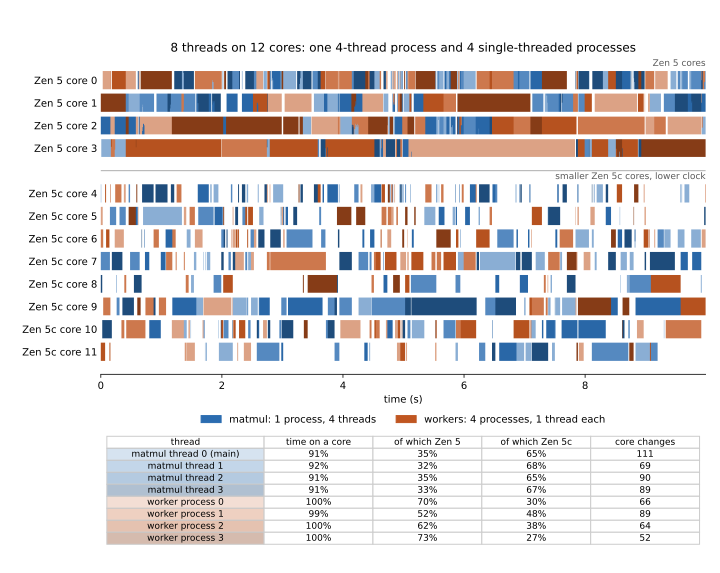
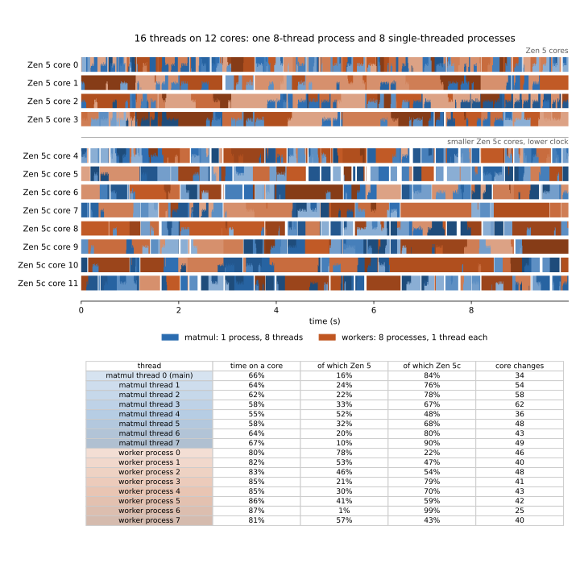

# Threads and processes on cores

A companion to [Lecture 09: Processes and Threads](../../course_materials/09.threads.md).

The OS schedules **threads** onto cores, not processes. To the scheduler, a
process with eight threads and eight single-threaded processes are the same
thing: eight runnable threads competing for cores. The only difference between
them is memory: the threads share one address space, and the processes each
have their own.

This example runs both kinds of program at once on the same 12 cores, records
which core every thread is on every 10 ms, and draws it.

* `omp_matmul.c`: **one process, K threads**. It repeats a 1024 × 1024
  single-precision matrix multiply with `#pragma omp parallel for` over the
  rows of C. OpenMP creates its team of K threads once, at the parallel
  region, and the main thread is one of them. The loop is split into equal
  pieces, one per thread. Every multiply ends at a barrier, so each thread
  waits for the slowest one before starting the next.
* `fork_workers.c`: **K processes, one thread each**. This is the lecture's
  `fork` example in a loop: the parent `fork()`s K children and `wait()`s for
  them. Each child estimates pi by Monte Carlo sampling, which keeps one core
  busy and touches almost no memory.
* `sample.py` reads `/proc/<pid>/task/<tid>/stat` and `schedstat` for every
  thread every 10 ms. A thread counts as running on a core during an interval
  if it is in state `R` and its CPU time grew.
* `plot_timeline.py` draws one row per core, with blue for the matmul threads
  and orange for the worker processes. Where two threads took turns on a core
  within one 10 ms interval, it splits the bar's height between them by the
  CPU time each one got.

```
make
./run.sh                                    # writes fits.csv, oversubscribed.csv
python3 plot_timeline.py fits.csv oversubscribed.csv
```

`run.sh` warms the clock first. Then it starts both workloads together under
`taskset -c 0-11` and samples for 10 seconds. It does this twice:

| run | matmul threads | worker processes | total |
|---|---|---|---|
| `fits` | 4 | 4 | 8, fewer than the 12 cores |
| `oversubscribed` | 8 | 8 | 16, more than the 12 cores |

## The machine

AMD Ryzen AI 9 HX 370 running Linux. It has 12 cores of two kinds:

* 4 **Zen 5** cores, with a maximum clock of 5.16 GHz.
* 8 **Zen 5c** cores. These are a smaller version of the same design, with a
  maximum clock of 3.29 GHz.

Both kinds run the same instructions, so the scheduler can put any thread on
any core.

*Machine setup:* the experiment uses one CPU number per physical core, read
from `/sys/devices/system/cpu/cpu*/topology/core_id` and `cpufreq/cpuinfo_max_freq`.
CPUs 0–3 are Zen 5 cores 0–3, and CPUs 4–11 are Zen 5c cores 4–11 (`core_id`
8–15). Both workloads ran under `taskset -c 0-11` at nice 12, which they
inherited from the shell, with a desktop and browser running at the same time.

## Results





The table under each figure comes from the run plotted. "Time on a core" is the
share of wall-clock time the thread spent running. "Of which Zen 5" is the share
of that running time spent on a fast core. "Core changes" counts how often the
CPU a thread last ran on differed between two samples taken 10 ms apart. It is
a lower bound, because a thread can move and move back within 10 ms.

**`fits` (4 + 4 threads on 12 cores)**

| thread | time on a core | Zen 5 | Zen 5c | core changes |
|---|---|---|---|---|
| matmul thread 0 (main) | 91% | 35% | 65% | 111 |
| matmul thread 1 | 92% | 32% | 68% | 69 |
| matmul thread 2 | 91% | 35% | 65% | 90 |
| matmul thread 3 | 91% | 33% | 67% | 89 |
| worker process 0 | 100% | 70% | 30% | 66 |
| worker process 1 | 99% | 52% | 48% | 89 |
| worker process 2 | 100% | 62% | 38% | 64 |
| worker process 3 | 100% | 73% | 27% | 52 |

**`oversubscribed` (8 + 8 threads on 12 cores)**

| thread | time on a core | Zen 5 | Zen 5c | core changes |
|---|---|---|---|---|
| matmul thread 0 (main) | 66% | 16% | 84% | 34 |
| matmul thread 1 | 64% | 24% | 76% | 54 |
| matmul thread 2 | 62% | 22% | 78% | 58 |
| matmul thread 3 | 58% | 33% | 67% | 62 |
| matmul thread 4 | 55% | 52% | 48% | 36 |
| matmul thread 5 | 58% | 32% | 68% | 48 |
| matmul thread 6 | 64% | 20% | 80% | 43 |
| matmul thread 7 | 67% | 10% | 90% | 49 |
| worker process 0 | 80% | 78% | 22% | 46 |
| worker process 1 | 82% | 53% | 47% | 40 |
| worker process 2 | 83% | 46% | 54% | 48 |
| worker process 3 | 85% | 21% | 79% | 41 |
| worker process 4 | 85% | 30% | 70% | 43 |
| worker process 5 | 86% | 41% | 59% | 42 |
| worker process 6 | 87% | 1% | 99% | 25 |
| worker process 7 | 81% | 57% | 43% | 40 |

### What we observed

**The fast cores went to the worker processes, in both runs.** With 8 threads
on 12 cores, the workers spent 52–73% of their running time on the four Zen 5
cores, and the matmul threads 32–35%. An even spread would put a third of
everyone's time on Zen 5. Across three repeat runs, the workers averaged
52–72% and the matmul 29–39%. When oversubscribed, the gap narrowed but held:
the workers averaged 41% on Zen 5 and the matmul 25–26%, in both of the runs
that recorded CPU time.

The scheduler did not choose the workers because they are processes, since
it makes no distinction between threads and processes. It chose them because
they never stop. A matmul thread sleeps at the barrier at the end of every
multiply, waiting for its slowest sibling, and so gives up its core. A worker
never sleeps, so it is the thread already running when a fast core frees up.

This is the lecture's warning that equal work is not equal time. OpenMP gives
each matmul thread the same number of rows, and a thread on a Zen 5c core,
at under two-thirds the clock, takes longer over them. The threads that finish
first sleep at the barrier until it catches up. Those sleeps show up as the
matmul threads' "time on a core" of 91–92%, against 99–100% for the workers,
and each sleep is a chance for a worker to take the fast core. (The sampler
does not record which thread reached each barrier last, so this is the
explanation that fits the numbers, not something measured directly.)

**Threads move constantly, even when there are cores to spare.** In `fits`,
every thread changed cores 50–110 times in 10 seconds, even though 4 of the 12
cores were idle at any moment. The scheduler was free to leave each thread
where it was, and it didn't.

**Oversubscribed, the cores take turns, and the threaded program pays more.**
With 16 threads on 12 cores, every row of the figure is full and is split
between threads that share the core in slices of a few milliseconds. Each
change of colour within a row is a context switch. This is concurrency on
each core, on top of parallelism across the 12. The
workers ran 80–87% of the time and the matmul threads only 55–67%. A preempted
matmul thread holds up the barrier for all of its siblings, who sleep while
they wait, so a delay to one thread costs the whole process. Run without the
sampler, the matmul finished 61–62 multiplies in 11 seconds with 4 threads and
63 with 8. Doubling the threads bought about 2% more work.

The sampler is not free. With it running, the matmul managed only 48
multiplies in either configuration, so treat the "time on a core" column as
measured on a machine with one more busy program than the figure shows.
